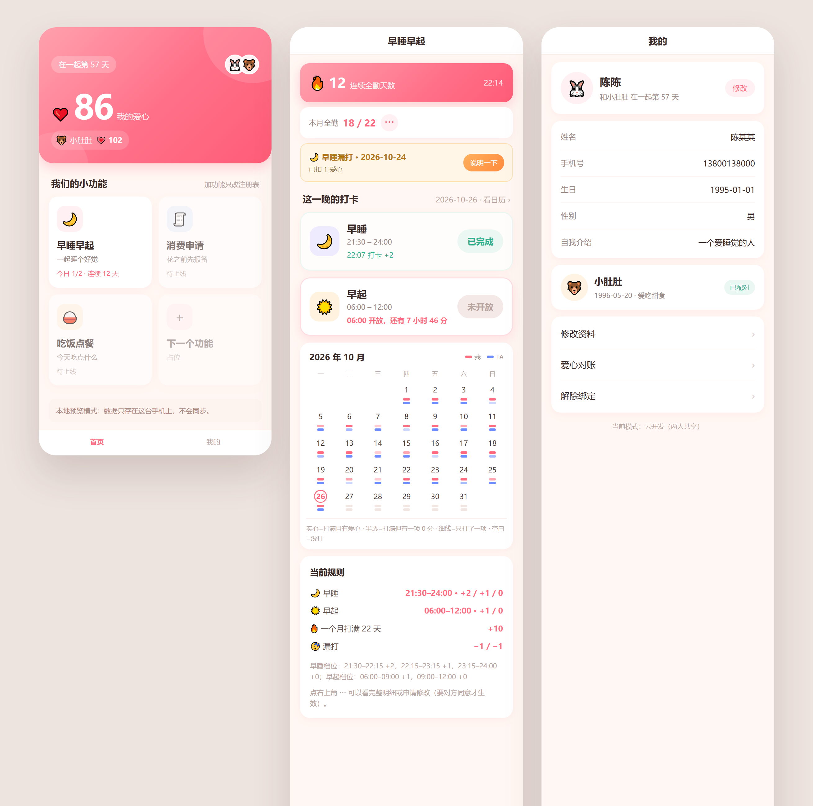

# 我们的小心动 · 情侣打卡小程序

一个**只给两个人用**的微信小程序：每晚早睡、每早早起，打卡得爱心，爱心以后用来换礼物。

不是社交产品，没有陌生人、没有排行榜、没有充值。两个人，一本账，一个日历。



---

## 一、现在有什么

| 模块 | 状态 | 一句话 |
|---|---|---|
| **打卡（早睡 / 早起）** | ✅ 完整可用 | 按打卡时间分档给爱心，漏打卡扣分，可申诉 |
| **爱心账本** | ✅ | 每人一本账，流水可查，随时对账 |
| **用户体系** | ✅ | 登记 6 项资料 → 邀请码配对 → 可解绑重来 |
| **规则自定义** | ✅ | 窗口、档位、扣分、全勤门槛都能在界面上改，改规则要对方同意 |
| **工单（审批）** | ✅ | 缺卡申诉、改规则，都走「我的 → 消息申请」 |
| 消费申请 | ⬜ 占坑 | 「花之前先报备」，>50 元才需要 |
| 吃饭点餐 | ⬜ 占坑 | 「今天吃什么」，投票撮合 |
| 礼物商城 | ⬜ 未开始 | 爱心换礼物，支持独自买 / 合资买 |

---

## 二、功能细节

### 2.1 用户体系

**登记（首次进入必填）**

| 字段 | 规则 | 谁能看到 |
|---|---|---|
| 用户 ID | 2~12 字，中文/字母/数字/下划线/短横线，**全局唯一** | 双方 |
| 真实姓名 | 2~20 字 | 双方 |
| 手机号 | 11 位，`1` 开头（**只能手填**，个人主体用不了微信的"手机号快捷验证"） | 双方 |
| 生日 | `YYYY-MM-DD` | 双方 |
| 性别 | 男 / 女 / 其他 | 双方 |
| 自我介绍 | ≤ 100 字（选填） | 双方 |
| 头像 | 从 10 个 emoji 里选 | 双方 |

**配对**：一方生成 6 位邀请码 → 另一方输入 → 绑定。
三条硬约束由内核守：一人同时只能属于一段关系 / 一段关系最多两人 / 配对后双方 `coupleId` 必须一致。

**门禁**：**没登记、没配对时，任何功能模块都调不通**（内核在组装上下文时就拦掉，不是靠界面藏按钮）。

**解绑**：弹两次确认 + 服务端要求 `confirm: true`。解绑后：
1. 这段关系标记为 `dissolved`（数据**封存不删除**）
2. 双方的爱心各写一条反向流水清零（余额归 0，但历史可查）
3. 双方各自拿到一条全新的 `pending` 关系和新邀请码

**资料随时可改**，改用户 ID 会重新查重。

### 2.2 打卡规则（默认值，全部可在界面上改）

**早睡**（窗口 21:30 – 24:00）

| 打卡时刻（左闭右开） | 爱心 |
|---|---|
| 21:30 – 22:15 | **+2** |
| 22:15 – 23:15 | **+1** |
| 23:15 – 24:00 | **0**（记在日历上，不给分） |
| 24:00 前没打 | **−1**，并开放「说明一下」申诉入口 |

**早起**（窗口 06:00 – 12:00）

| 打卡时刻 | 爱心 |
|---|---|
| 06:00 – 09:00 | **+1** |
| 09:00 – 12:00 | **0** |
| 12:00 前没打 | **−1**，同样可申诉 |

**月度全勤**：一个自然月里"两项都打卡"的天数 ≥ **22 天** → **+10**。
奖励在**打满第 22 天的那一刻**发放，不用等到月底；同一个月只发一次。

**爱心下限是 0**：扣分扣到 0 就停，不会出现负余额。

### 2.3 打卡日：不是自然日

这是最容易搞错、也最影响正确性的一个设计：

> **中午 12:00 之前的打卡，算前一天的。**

```
10-26 22:30 早睡   → 打卡日 10-26
10-27 06:40 早起   → 打卡日 10-26   ← 同一晚！
                     两项齐 → 这一晚算"全勤"
11-01 06:00 早起   → 打卡日 10-31   ← 会算进 10 月的日历
```

没有这个，早睡（D 日）和早起（D+1 日）永远不在同一个日期上，全勤和连续天数永远不成立。
切分点 `cutoverHour` 可配，但**必须落在没有打卡活动的空档里**（早起结束后、早睡开始前），否则日期会整体偏移 —— 这条由校验器强制拦截。

### 2.4 当月日历

打卡页有一张整月日历，一格内两条小横条：

| 标记 | 含义 |
|---|---|
| 粉色实心 | 我打满了两项，且拿到了爱心 |
| 粉色半透 | 我打满了两项，但有一项是 0 分档 |
| 粉色细线 | 我只打了一项 |
| 空白 | 那天没打 |
| 蓝色 | 同上的 TA（对方） |

今天的格子有描边。日历按**打卡日**归属，所以 11-01 早上的早起会显示在 10-31 那格。

### 2.5 爱心账本

**每人一本账，互不影响**：

```
core_wallets   _id = openid，只存当前余额
heart_logs     只追加的流水，余额 = sum(delta)
```

三条不变式（有测试盯着）：

1. `钱包余额 === 该用户所有流水之和`（跨解绑也成立）
2. `余额 >= 0`
3. 同一个 `idemKey` 只会写一条流水（防重复发放）

**对方余额可见但不可动** —— 首页显示两个数字，扣款接口只接受"我自己"的 openid。
「我的 → 爱心对账」会当场比对余额和流水之和。

### 2.6 漏打卡扣分怎么触发

扣分不是用户点出来的，是"时间到了"触发的。云函数没有常驻进程，所以用**双保险**：

```
① 定时触发器   config.json 里的 settleHourly，每小时第 5 分钟跑一次
              遍历所有已配对用户，检查最近 3 个打卡日
② 惰性补算     每次打开打卡页 / 首页也会顺手结算一次
③ 幂等键       idemKey = miss:<类型>:<打卡日>
              跑多少次都只扣一次
```

**边界**：只结算"配对之后"的打卡日 —— 刚配对不会被倒扣历史。

### 2.7 缺卡申诉

漏打后打卡页会出现橙色卡片：「🌙 早睡漏打 · 2026-10-24 / 已扣 1 爱心 / [说明一下]」。

```
我写理由 → 生成工单（late_night / late_wake）→ 对方在「消息申请」看到
对方同意 → 爱心退回（新增一条流水，原扣分记录保留）
对方拒绝 → 扣分保留
```

申诉有截止时间（默认早睡次日 12:00、早起当日 24:00），过期按钮变成「申诉已过期」。

### 2.8 规则自定义

**打卡页右上角 ⋯** → 查看规则明细 / 申请修改规则。

可改的项：

| 分组 | 参数 |
|---|---|
| 早睡 | 窗口起止、各档时间边界、各档爱心、漏打扣分、申诉截止 |
| 早起 | 同上 |
| 月度 | 达标天数（1~31）、奖励爱心、统计口径 |
| 高级 | 打卡日切分点（`cutoverHour`） |

**改规则要走审批**：提交后生成工单 → 对方同意 → **从那一刻起**生效。
- 已发的爱心是流水，**不会因为改规则而回滚**
- 存的是**完整快照**，不是差异 —— 同意后规则长什么样完全可预期
- 校验器（前后端共用）会拦：窗口倒置、档位没覆盖到窗口、档位不连续、爱心越界、`cutoverHour` 落在打卡时段里……

### 2.9 工单（审批）机制

内核里有一套通用的工单，打卡申诉和改规则都复用它，以后的消费申请也直接接：

```
pending → approved / rejected
```

- 同一件事同时只能有一个待处理工单（防连点）
- 只有 `toOpenid` 能处理，别人点会报"不归你处理"
- 内核只管状态机；"同意后干什么"由各模块的 `onDecision` 实现

入口：**我的 → 消息申请**（有待处理时显示红点），分「待我处理 / 我发起的」。

### 2.10 首页（外壳）

首页不认识任何具体功能，只做三件事：问内核要会话（我是谁 / 双方余额 / 在一起几天）→ 按**前端注册表**渲染两列宫格 → 问每个模块要一句摘要。

```
加一个新功能 = 新建模块目录 + 注册表加一行
```

两个没做完的模块（消费申请、吃饭点餐）现在显示为灰卡「待上线」。
⚠️ **上线前要把它们从注册表里删掉**，不然审核可能判"功能未完成"。

### 2.11 本地预览模式

没填云开发环境 ID 时，小程序自动走本地模式：数据存在手机本地，界面完全可用（含打卡、日历、假规则）。
适合改样式、调交互、给不懂技术的人看效果。**不能真的配对和审批。**

---

## 三、数据模型

| 集合 | 作用 | 关键字段 |
|---|---|---|
| `profiles` | 用户登记信息 | `openid`、`userId`、`realName`、`phone`、`birthday`、`gender`、`bio`、`coupleId` |
| `couples` | 一段关系 | `inviteCode`、`status`(pending/active/dissolved)、`members[]`、`pairedAt` |
| `core_wallets` | 个人钱包 | `_id = openid`、`balance` |
| `heart_logs` | 爱心流水 | `openid`、`delta`、`reason`、`module`、`idemKey`、`date` |
| `checkins` | 打卡记录 | `openid`、`coupleId`、`date`（打卡日）、`type`、`at`、`hearts` |
| `core_settings` | 规则快照 | `coupleId` + `module`、`patch`（完整快照）、`history[]` |
| `core_approvals` | 工单 | `module`、`type`、`fromOpenid`、`toOpenid`、`status`、`payload` |

**所有集合的权限都设「所有用户不可读写」** —— 客户端碰不到数据库，只能走云函数。

---

## 四、技术架构

```
                    ┌──────── 内核 core（稳定）────────┐
                    │ identity   身份与关系           │
                    │ hearts     个人爱心账本         │
                    │ clock      时间与打卡日         │
                    │ approvals  工单状态机           │
                    │ scheduler  定时结算             │
                    │ shell      路由/返回/门禁/注册表 │
                    └──────────────┬─────────────────┘
                                   │ 模块只能通过 ctx 说话
                    ┌──────────────┴─────────────────┐
                    │ checkin（打卡）  consumption …  │
                    │ 自有集合/页面/规则/奖励         │
                    └────────────────────────────────┘
```

四条硬规则：

1. 模块只通过 `ctx` 用内核，**不 require 任何别的模块**
2. 每个模块只读写自己声明的集合（内核会拦越权访问）
3. 加功能 = 新目录 + 注册表一行；改了已有模块就是架构失败
4. 内核里只放"事实"（我是谁 / 我有多少爱心 / 现在几点 / 待审批的单子），不放"流程"

**接口命名**：`<模块>.<动作>`，如 `checkin.act`、`checkin.detail`；系统级用 `session.*`、`approvals.*`、`settle.run`。

---

## 五、目录结构

```
情侣软件vibe coding/
├─ 起步方案.md / 架构设计.md / 内核设计.md      设计与决策记录
├─ 打卡规则v2.md                              规则参数表（可配项 + 取值范围）
├─ 待办与开发步骤.md                          ⭐ 工作清单
├─ 上线与分享指南.md                          怎么给别人用 / 怎么正式上线
├─ shared/                                    ⭐ 唯一真相（改这里）
│  ├─ clock.js                                时间工具
│  └─ checkin-rules.js                        打卡规则：默认值 + 判定 + 校验器
├─ miniprogram/                               小程序
│  ├─ app.js / app.json / app.wxss
│  ├─ core/                                   api / session / modules(注册表) / mock / cloud
│  ├─ modules/checkin/api.js                  打卡模块的接口层
│  ├─ utils/                                  config.js（环境 ID）、clock.js、rules.js（生成物）
│  └─ pages/
│     ├─ home/                                首页：外壳 + 两列宫格
│     ├─ mine/                                我的：资料 / 对账 / 消息申请 / 解绑
│     ├─ approvals/                           消息申请（审批）
│     ├─ register/                            登记 & 修改资料
│     └─ m/checkin/                           打卡页 + rules/ 规则编辑页
├─ cloudfunctions/api/
│  ├─ index.js                                路由（无业务）
│  ├─ core/                                   内核 7 个文件
│  ├─ modules/checkin/                        打卡模块（index / store / rules）
│  ├─ modules/{consumption,meal}/             ⬜ 占坑
│  └─ config.json                             ⚠️ 定时触发器声明在这里
├─ design/                                    设计预览（HTML + 截图）
└─ scripts/                                   同步脚本 + 两套测试
```

---

## 六、跑起来

### 本地看看（10 分钟，不用注册）

1. 装[微信开发者工具](https://developers.weixin.qq.com/miniprogram/dev/devtools/download.html)
2. 「导入项目」→ 选这个目录 → AppID 选「**测试号**」
3. 编译后就是**本地预览模式**，界面全部可点

### 接上云端（两台手机同步）

1. 开发者工具顶部「云开发」→ 开通 → 新建环境 → 复制**环境 ID**
2. 填进 `miniprogram/utils/config.js` 的 `envId`
3. 云开发控制台建 **7 个集合**（见上面「数据模型」），权限都选「所有用户不可读写」
4. 右键 `cloudfunctions/api` → **上传并部署：云端安装依赖**
5. 编译 → 首次进入会要求登记

> 部署会一起带上**定时触发器**（每小时结算漏打卡）。去控制台 → 云函数 → api → 定时触发器确认有 `settleHourly`。

### 给别人用 / 正式上线

见 [上线与分享指南.md](上线与分享指南.md)，包括不备案（体验版）和备案（正式发布）两条路、审核风险和解法。

---

## 七、测试

两套测试，**138 条断言**，改完代码跑一遍：

```powershell
node scripts/smoke-test.mjs   # 规则引擎 + 本地模式流程（53 条）
node scripts/cloud-test.mjs   # 云函数全流程，用假数据库，不用部署（85 条）
```

或者双击 **`同步规则.bat`**：同步生成物 + 跑两套测试 + 提醒你部署。

改了规则（`shared/checkin-rules.js`）之后必须三步：改 → 双击 bat → **重新部署云函数**。

---

## 八、已知限制（先说清楚，免得踩坑）

1. **档位数量固定**：界面上能改档位边界和分值，但不能增删档位（增删等于改规则结构）。
2. **同步奖默认关闭**：`syncBonus: 0`，想开改成 1 即可，代码不用动。
3. **本地预览模式不能审批**：会提示"配好云开发再用"。
4. **结算使用"当前规则"**：如果定时器漏跑好几天才补算，会按最新规则扣分（影响极小，因为大多是当天结算）。
5. **审核员配不了对**：正式上线前需要加"演示模式"或在审核备注里写清双人体验方式，否则可能被拒（见上线指南）。

---

## 九、下一步

详细清单在 [待办与开发步骤.md](待办与开发步骤.md)。近期候选：

| 优先级 | 事项 |
|---|---|
| 高 | 先用 1~2 周，收集真实使用中的规则尺度问题 |
| 中 | 消费申请模块（第一个走完整模块流程的新功能，也是架构验收考试） |
| 中 | 上线前：删占位模块 + 加演示模式 |
| 低 | 礼物商城（独自买 / 合资买，爱心消费端） |
| 低 | 通知提醒（订阅消息） |
