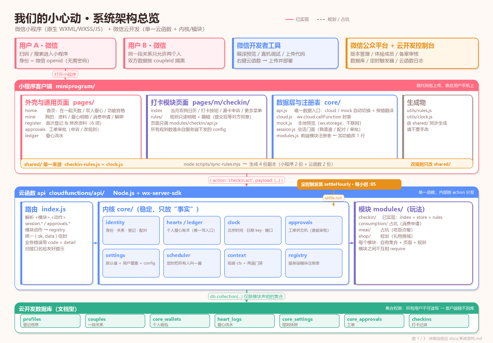
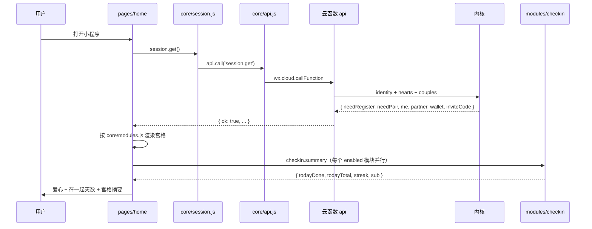
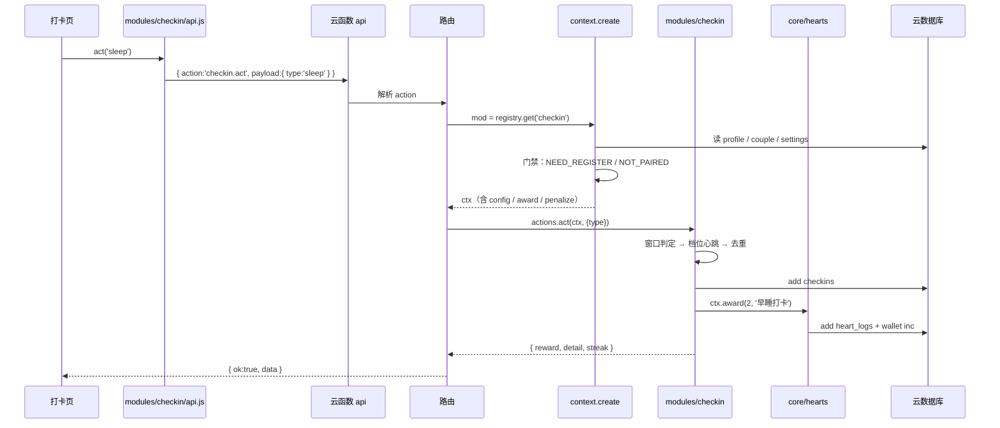
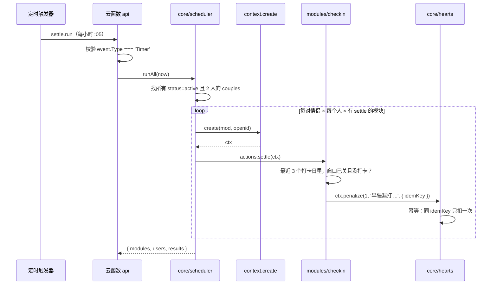
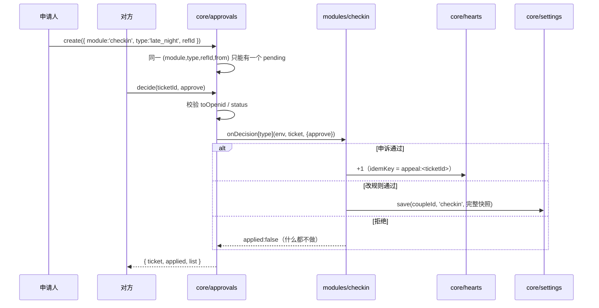
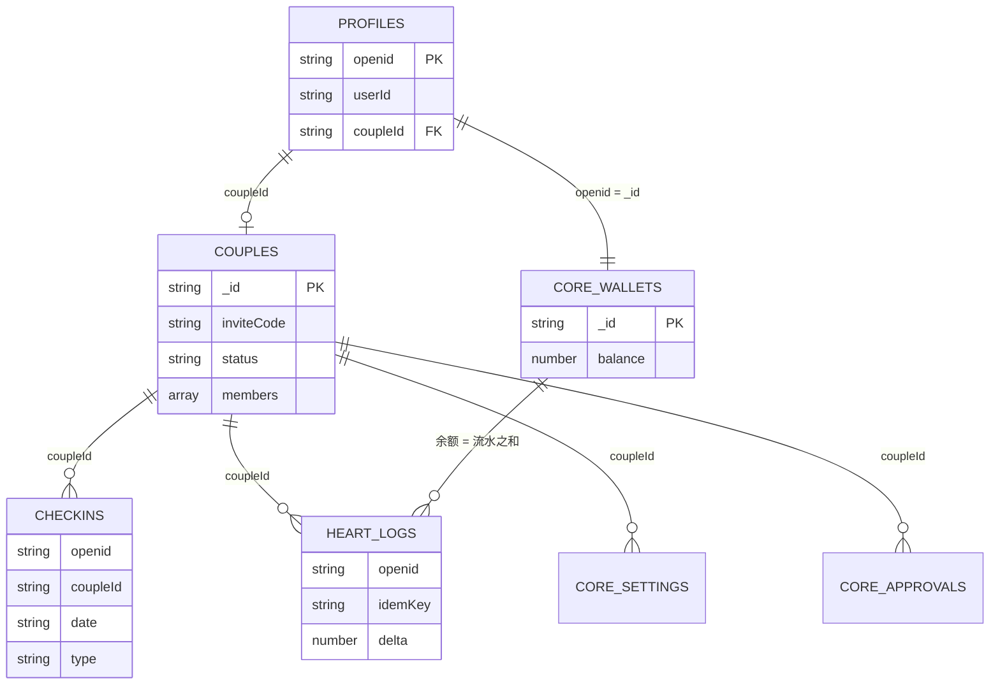
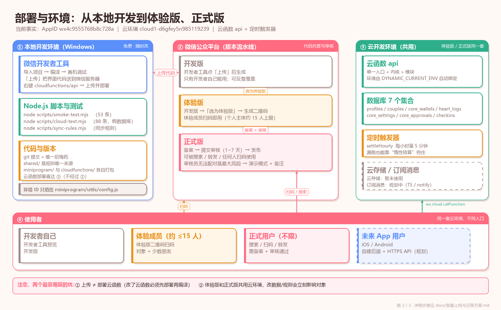

# 系统架构

> 适用版本：2026-10-27 ｜ 代码基线：`4b513cb` 之后（P1a–S4 已完成）
> 读者：想快速理解「这个项目是怎么搭起来的」以及「以后加功能该往哪写」的人 / AI。
> 本文只讲**分层、边界、运行链路、扩展方式**；规则细节见 [`../module-dev/checkin/规则文档.md`](../module-dev/checkin/规则文档.md)，代码逐行讲解见 [`代码详解.md`](代码详解.md)。

**目录**：一、一页结论 ｜ 二、技术选型与运行环境 ｜ 三、分层架构 ｜ 四、运行时链路 ｜ 五、模块契约 ｜ 六、数据架构 ｜ 七、部署架构 ｜ 八、关键设计决策 ｜ **九、后续功能怎么拓展** ｜ 十、边界与风险 ｜ 十一、目录与术语 ｜ 十二、相关文档

---

## 一、一页结论

**形态**：微信小程序（原生 WXML/WXSS/JS，不引框架） + 微信云开发（云函数 + 云数据库 + 定时触发器）。

**结构**：一个小程序外壳 + 一个云函数；云函数内部再分「内核 core」和「模块 modules」。

```
用户手机（微信）
   │  wx.cloud.callFunction({ action: 'checkin.act', payload })
   ▼
云函数 api（唯一入口，Node.js）
   ├─ index.js        路由：把 '模块.动作' 分发给模块
   ├─ core/           内核：身份 / 爱心账本 / 时间 / 工单 / 配置 / 调度 / 上下文
   └─ modules/        玩法：checkin（已实现）、consumption / meal / shop（规划）
   ▼
云开发数据库（7 个集合，权限「所有用户不可读写」，只有云函数能碰）
```

**一句话记住边界**：

> 内核 = 情侣身份 + 爱心账本 + 时间 + 审批状态机 + 外壳管道；模块 = 玩法。
> 模块只通过 `ctx` 跟内核说话，模块之间互不认识。



---

## 二、技术选型与运行环境

### 2.1 选型表

| 项 | 选择 | 版本 / 现状 | 为什么 |
|---|---|---|---|
| 客户端 | 微信小程序原生 | 基础库需 ≥ 2.2.3（云开发要求） | 零安装、扫码即用；Windows 能完整开发 |
| 客户端框架 | 无（不用 uni-app / Taro / TDesign） | — | 项目小，手写 WXML 更可控，出错容易定位 |
| 后端 | 微信云开发 · 单云函数 `api` | `wx-server-sdk` `~2.6.3` | 免服务器、免备案域名、免 HTTPS 配置 |
| 数据库 | 云开发文档型数据库 | 7 个集合 | 免运维；两人使用量极小 |
| 定时任务 | 云开发定时触发器 `settleHourly` | `0 5 * * * * *`（每小时第 5 分钟） | 漏打卡扣分需要「时间到了」触发 |
| 身份 | 微信 `openid` | 云函数 `getWXContext().OPENID` | 不用做注册/密码体系 |
| 本地预览 | `wx.storage` + mock 数据层 | `miniprogram/core/mock.js` | 没配云环境也能点完整界面 |
| 测试 | Node 脚本 + 假数据库 | `smoke-test.mjs` 53 条、`cloud-test.mjs` 88 条 | 不连真云也能跑全流程，改完立刻验证 |
| 规则单一来源 | `shared/` | 同步生成 4 份副本 | 小程序包和云函数包互相引用不到，只能复制 |

### 2.2 开发环境（当前实际使用）

| 工具 / 事实 | 值 | 用途 |
|---|---|---|
| 操作系统 | Windows | 微信开发者工具 + Node + Git |
| 微信开发者工具 | 最新稳定版 | 编译、预览、真机调试、上传、部署云函数 |
| Node.js | v22.23.2（本机实测） | 跑测试、同步规则、生成文档图 |
| 小程序 AppID | `wx4c9555768b8c728a` | `project.config.json` |
| 云开发环境 ID | `cloud1-d6gfey5n985119239` | `miniprogram/utils/config.js` 的 `envId` |
| 云函数目录 | `cloudfunctions/api/` | 右键「上传并部署：云端安装依赖」 |
| 小程序目录 | `miniprogram/` | 代码包根目录 |
| 版本管理 | Git（本地） | 每次改动提交；是目前唯一的回滚手段 |

> **没有的东西**：没有服务器、没有域名、没有 CI/CD、没有 npm 前端依赖、没有自动化 UI 测试。
> 这不是缺陷，是「两个人用」这个规模下的刻意取舍。什么时候该补，见第十节。

### 2.3 一次请求用到哪些运行时

| 运行位置 | 代码 | 权限 |
|---|---|---|
| 用户手机（微信客户端） | `miniprogram/**` | 只能调云函数；**连不上数据库** |
| 微信云（云函数） | `cloudfunctions/api/**` | 能读写数据库、能拿 `OPENID`、能发订阅消息（未实现） |
| 微信云（数据库） | 7 个集合 | 集合权限设为「所有用户不可读写」 |
| 微信云（定时器） | `config.json` 的 `triggers` | 定时调用云函数 `settle.run` |
| 本地电脑（可选） | `scripts/**` | 跑测试、同步规则、生成图；不参与线上 |

---

## 三、分层架构

### 3.1 四层 + 一条数据流

```
┌─────────────────────────────────────────────────────────────┐
│ ① 外壳层（小程序）                                           │
│    pages/home、pages/mine、pages/register、pages/approvals   │
│    职责：导航、会话展示、功能宫格；不认识任何具体玩法          │
├─────────────────────────────────────────────────────────────┤
│ ② 模块页面层（小程序）                                       │
│    pages/m/checkin/、pages/m/checkin/rules/                  │
│    职责：某个玩法的界面；只调 modules/<key>/api.js            │
├─────────────────────────────────────────────────────────────┤
│ ③ 数据访问层（小程序）                                       │
│    core/api.js（cloud/mock 切换）、core/cloud.js、core/mock.js│
│    core/session.js（会话门面）、core/modules.js（前端注册表） │
│    职责：统一 action 协议、错误翻译、离线预览                 │
├─────────────────────────────────────────────────────────────┤
│ ④ 云函数层                                                   │
│    index.js 路由 → core/* 内核 → modules/* 模块 → 云数据库    │
│    职责：鉴权（openid）、门禁、规则判定、记账、审批、定时结算  │
└─────────────────────────────────────────────────────────────┘
```

### 3.2 每层的「必须做 / 禁止做」

| 层 | 必须做 | 禁止做 | 代码位置 |
|---|---|---|---|
| 外壳 | 从 `session.get` 拿会话；按注册表渲染宫格；问模块要 `summary` | 写 `if (key === 'checkin')`；直接调具体模块 | `pages/home/home.js` |
| 模块页面 | 只调本模块的 `modules/<key>/api.js`；渲染服务端下发的 `config` | 自己发明奖励/判定；把规则写死在页面；直接读写缓存当真相 | `pages/m/checkin/**` |
| 数据层 | 统一 `api.call(action, payload)`；把云错误翻译成人话 | 把业务规则写进 `api.js`；在页面里直接 `wx.cloud` | `core/api.js`、`core/cloud.js` |
| 路由 | 解析 `<模块>.<动作>`；统一返回信封；兜底错误 | 出现任何业务词（打卡 / 爱心 / 礼物） | `cloudfunctions/api/index.js` |
| 内核 | 身份、账本、时间、配置合并、工单状态机、调度 | `require` 具体模块的业务代码（注册表除外）；出现玩法词 | `cloudfunctions/api/core/*` |
| 模块 | 声明自己的集合；实现 `summary/detail/act`；通过 `ctx` 用内核 | `require` 另一个模块；访问未声明集合；绕过 `ctx.award` 改余额 | `cloudfunctions/api/modules/checkin/*` |
| 数据库 | 只被云函数访问；集合权限全关 | 客户端直连；跨模块共表 | 云开发控制台 |

### 3.3 依赖方向（只允许向下 / 向内核）

```
pages ──► modules/<key>/api.js ──► core/api.js ──► core/cloud.js ──► 云函数
                                                      │
                                                      └─► core/mock.js（本地模式）

云函数 index.js ──► core/context.js ──► core/{identity,hearts,clock,settings}
       │                │
       │                └─► core/db.js（唯一初始化 wx-server-sdk 的地方）
       └─► core/registry.js ──► modules/<key>/index.js ──► ctx.*（只拿内核能力）
                                      │
                                      └─► modules/<key>/store.js ──► ctx.db（白名单集合）
```

**唯一的例外**：`core/registry.js` 里 `require('../modules/checkin/index.js')`。
它不是业务依赖，而是**组装根**（composition root）—— 就像插线板，只负责把模块接上，不参与模块逻辑。
`core/scheduler.js` 和 `core/approvals.js` 通过注册表拿到模块，也不直接写死模块名。

---

## 四、运行时链路

### 4.1 打开首页（外壳如何做到不认识打卡）



关键点：

- 首页**没有** `checkin` 字符串（除了注册表数据），加模块只改 `core/modules.js`。
- 没配对时首页不请求模块（门禁会拒），只显示邀请码卡片。
- 每个模块的卡片摘要由模块自己决定（`summary.sub`），首页只负责摆位置。

### 4.2 打卡（写操作）



### 4.3 定时结算（没有常驻进程怎么办）



**双保险**：定时器可能漏跑，所以 `summary` / `detail` 里也会顺手调一次 `settle`。
这就是为什么「打开小程序时，昨晚的扣分会补上」。

### 4.4 审批（申诉 / 改规则）



---

## 五、模块契约与依赖规则

### 5.1 一个模块长什么样

```js
// cloudfunctions/api/modules/<key>/index.js
module.exports = {
  key: 'checkin',                 // 唯一标识，也是 action 前缀
  name: '早睡早起',
  emoji: '🌙',
  version: 3,

  collections: ['checkins'],      // 本模块独占的集合（越权会被 ctx.db 拦）

  defaults: { /* 规则默认值，用户可在界面覆盖 */ },

  actions: {                      // 路由会暴露为 checkin.summary / detail / act ...
    summary, detail, act, history, settle, appeal, proposeConfig
  },

  on: {},                         // 事件订阅（未启用）
  onDecision: {                   // 审批通过/拒绝后，模块自己承担后果
    late_night, late_wake, rules_change
  }
}
```

### 5.2 `ctx` 是模块能看到的全部世界

| 字段 | 类型 | 含义 | 谁给的 |
|---|---|---|---|
| `ctx.openid` | string | 当前用户 | 云函数 `getWXContext()` |
| `ctx.me` | object | 我的公开资料（userId / 头像 / 生日…） | identity |
| `ctx.partner` | object \| null | 对方公开资料；未配对为 null | identity |
| `ctx.coupleId` | string | 当前关系 id；没配对也有（临时关系） | identity |
| `ctx.couple` | object \| null | 关系文档（含 `pairedAt`、`members`） | identity |
| `ctx.coupleStatus` | string | `pending` / `active` / `dissolved` / `none` | identity |
| `ctx.isPaired` | boolean | 是否已配对 | identity |
| `ctx.now` | number | **服务器时间戳**（不是手机时间） | context |
| `ctx.dateKey` | string | 北京时间 `YYYY-MM-DD` | clock |
| `ctx.config` | object | `defaults + core_settings 覆盖` 合并后的规则 | settings |
| `ctx.db` | object | 只能访问 `collections` 里声明过的集合 | db + context |
| `ctx.award(n, reason, opts)` | function | 给自己加爱心，返回实际变动 | hearts |
| `ctx.penalize(n, reason, opts)` | function | 给自己扣爱心，扣到 0 封顶 | hearts |
| `ctx.balance()` | function | 我的余额 | hearts |
| `ctx.emit(name, payload)` | function | 发事件（当前空转，等第一个订阅者） | context |

**故意不给的**：原始 `db` 句柄、`cloud` 对象、其他模块的引用、对方钱包的写权限。
不给，就写不出耦合代码。

### 5.3 四条硬规则

1. **模块只能通过 `ctx` 用内核**，永远不 `require` 另一个模块。
2. **每个模块只读写自己声明的集合**，别人的表连名字都不用知道。
3. **加一个功能 = 新增目录 + 注册表加一行**；如果改了已有模块的任何一行，就是架构失败。
4. **内核里只放「事实」，不放「流程」**：我有多少爱心是事实；发提醒、生成月报、解锁勋章是流程。

### 5.4 两个注册表

| 位置 | 作用 | 加功能改什么 |
|---|---|---|
| `cloudfunctions/api/core/registry.js` | 服务端模块清单，action 分发用 | `const MODULES = [checkin, study]` 加一行 |
| `miniprogram/core/modules.js` | 前端宫格清单，首页渲染用 | 加一个对象（key/name/emoji/page/enabled/order） |

两个表的 `key` 必须一致；`enabled: false` 的模块显示为灰卡「待上线」，点了不跳转。

---

## 六、数据架构

### 6.1 集合清单

| 集合 | 归属 | 作用 | 关键字段 |
|---|---|---|---|
| `profiles` | 内核 | 用户登记信息（一人一条） | `openid`、`userId`（全局唯一）、`realName`、`phone`、`birthday`、`gender`、`bio`、`avatarEmoji`、`coupleId` |
| `couples` | 内核 | 一段关系 | `inviteCode`（6 位）、`status`、`members[]`、`pairedAt`、`dissolvedAt`、`hearts`（旧字段） |
| `core_wallets` | 内核 | 个人钱包 | `_id = openid`、`balance`、`coupleId`、`updatedAt` |
| `heart_logs` | 内核 | 爱心流水（只追加） | `openid`、`coupleId`、`date`、`at`、`delta`、`reason`、`module`、`refId`、`idemKey` |
| `core_settings` | 内核 | 规则快照 | `coupleId`、`module`、`patch`（完整快照）、`history[]` |
| `core_approvals` | 内核 | 工单 | `module`、`type`、`coupleId`、`fromOpenid`、`toOpenid`、`refId`、`status`、`payload` |
| `checkins` | 打卡模块 | 打卡记录 | `openid`、`coupleId`、`date`（打卡日）、`type`、`at`、`hearts`、`source` |

### 6.2 关系图



### 6.3 命名规则

| 类型 | 规则 | 例子 |
|---|---|---|
| 内核集合 | `core_*` 或历史核心名 | `core_wallets`、`heart_logs`、`profiles` |
| 模块集合 | `m_<key>_<实体>` | `m_shop_orders`、`m_study_logs` |
| 历史遗留 | 不改名 | `checkins`（打卡模块一直用这个名字） |

> 不为了「整齐」搬已有数据。搬数据是纯风险、零收益；新模块用新命名即可。

### 6.4 三条不变式（有测试盯着）

1. `core_wallets.balance === sum(heart_logs.delta where openid = 该用户)`
2. `balance >= 0`（扣到 0 封顶，不允许透支）
3. 同一个 `idemKey` 只会写一条流水（防重复发放）

### 6.5 集合权限

全部设为「**所有用户不可读写**」。客户端拿不到数据库句柄，只能走云函数。
这是这套架构最重要的一条安全边界：**判定和记账全在服务端**，手机时间改不了结果。

---

## 七、部署架构



### 7.1 三个环境

| 环境 | 入口 | 是否需要备案 | 用什么代码 | 云环境 |
|---|---|---|---|---|
| 开发版 | 开发者工具 / 真机调试 | 否 | 本地最新代码 | 共用同一个 |
| 体验版 | 体验成员扫二维码 | 否 | 最近一次「上传」的代码 | 共用同一个 |
| 正式版 | 搜索 / 扫码 / 转发 | 是 | 审核通过的那次上传 | 共用同一个 |

**最容易误解的一点**：体验版和正式版**共用同一个云环境**。
你在开发者工具里部署云函数、改数据库，体验版用户立刻受影响；反之亦然。
所以「对象正在用的时候别乱改规则」不是客气话，是运维要求。

### 7.2 部署对象与顺序

| 要部署什么 | 怎么部署 | 生效范围 |
|---|---|---|
| 小程序界面 | 开发者工具「上传」→ 后台选为体验版 / 提审 | 客户端 |
| 云函数 | 右键 `cloudfunctions/api` → 上传并部署（云端安装依赖） | 所有客户端立刻 |
| 定时触发器 | 随云函数 `config.json` 一起部署 | 云端 |
| 数据库集合 | 云开发控制台手动创建 + 设权限 | 云端 |
| 规则默认值 | 改 `shared/` → 跑 `sync-rules.bat` → 部署云函数 | 云端 + 客户端生成物 |

> **顺序**：改了云函数，**先部署云函数，再编译小程序**。
> 云函数比界面新 → 旧界面会看到「界面还是旧版本，请编译」的友好提示；
> 界面比云函数新 → 会看到「没有这个功能/动作」的报错。

### 7.3 环境变量与配置

| 配置 | 在哪 | 说明 |
|---|---|---|
| `envId` | `miniprogram/utils/config.js` | 留空 = 本地预览模式；填了 = 连云 |
| `appid` | `project.config.json` | `wx4c9555768b8c728a` |
| 云函数环境 | `core/db.js` | `cloud.init({ env: cloud.DYNAMIC_CURRENT_ENV })`，自动跟随当前环境 |
| 定时触发器 | `cloudfunctions/api/config.json` | `settleHourly` 每小时第 5 分钟 |

---

## 八、关键设计决策（ADR 摘要）

| # | 决策 | 理由 | 代价 / 约束 |
|---|---|---|---|
| 1 | 小程序 + 云开发，不做原生 App | 零运维、对象不用装、Windows 能开发 | 受微信审核/类目/备案约束；性能上限低 |
| 2 | 不用前端框架 | 项目小，手写更可控；少一层构建 | 页面代码偏啰嗦；复用靠目录约定 |
| 3 | **一个云函数 + 内部模块化** | 少部署、少冷启动、少配置 | 单函数体积/超时上限；真慢了再拆路由 |
| 4 | 内核 + 模块，模块只认 `ctx` | 加功能不碰老功能 | 前期要多写一层 context/registry |
| 5 | 爱心是**个人钱包**，不是共享池 | 避免「谁买谁亏」；支持合资各付各的 | 首页要展示两个余额；迁移要按流水归属 |
| 6 | 账本只追加流水，余额是缓存 | 可对账、可修复、可审计 | 每次写要更新两处；有并发窗口 |
| 7 | **服务器时间**判定打卡 | 手机时间可伪造 | 云函数必须在线；离线只能预览 |
| 8 | 「打卡日」中午 12 点切分 | 早睡 D 日 + 早起 D+1 日要算同一晚 | 跨月归属反直觉；切分点必须落在空档 |
| 9 | 规则参数化 + 服务端下发 | 改规则不用发版；前后端只有一个真相 | 前端不能离线算奖励；配置校验要严 |
| 10 | 工单（审批）放内核 | 申诉/改规则/消费申请都要用；状态机必须唯一 | 内核多一个服务；模块要实现 `onDecision` |
| 11 | 未配对不能用任何模块 | 数据都挂在 `coupleId` 上，没配对就没有业务上下文 | 首次体验被拦；审核员体验不到（上线风险） |
| 12 | 先体验版，后正式版，再考虑 App | 先验证「每天点一下」这个习惯 | 正式上线要备案；App 是另一套工程 |

决策摘要如上。更早的设计文档已从工作区删除，原文保留在 git 历史里；当前实现以本文 + 代码 + 测试为准。

---

## 九、后续功能怎么拓展

### 9.1 先判断：这是哪一类改动？

```
新需求
 ├─ 只是换个页面/文案/样式？            → 改对应 page，不碰架构
 ├─ 一个新的「玩法闭环」（有页面/数据/规则）？ → 新增一个模块（9.2）
 ├─ 所有模块都要用的「事实」（身份/钱/时间/通知通道）？ → 加内核服务（9.3）
 └─ 两个模块要联动（打卡完成 → 萌宠吃饱）？ → 事件订阅（9.4，最后再做）
```

**模块的判据**：能不能单独删掉它，而其他功能照常工作？能，就是合格模块。

### 9.2 新增一个模块：9 步

以「学习计划 study」为例。

**第 1 步 · 写清边界（先想，别写代码）**

| 问题 | 答案示例 |
|---|---|
| 一句话玩法 | 建学习计划，每完成一节得爱心 |
| 自有集合 | `m_study_plans`、`m_study_logs` |
| 三个动作 | `summary`（首页摘要）、`detail`（页面数据）、`act`（完成一节） |
| 用内核的什么 | `ctx.me` / `ctx.partner`、`ctx.dateKey`、`ctx.award` |
| 要不要审批 | 不要（如果要，走 `core/approvals`） |
| 要不要通知 | 要（走 `notify`，未实现前先不做） |

**第 2 步 · 服务端建目录**

```
cloudfunctions/api/modules/study/
├─ index.js     契约 + actions
├─ store.js     只操作 m_study_plans / m_study_logs
└─ rules.js     纯逻辑（完成判定、奖励计算）
```

**第 3 步 · 写契约**

```js
// cloudfunctions/api/modules/study/index.js
const respond = require('../../core/respond.js')
const store = require('./store.js')
const rules = require('./rules.js')

module.exports = {
  key: 'study',
  name: '学习计划',
  emoji: '📚',
  version: 1,
  collections: ['m_study_plans', 'm_study_logs'],
  defaults: { heartsPerSection: 1, dailyLimit: 3 },

  actions: {
    async summary(ctx) {
      const done = await store.countToday(ctx)
      return {
        todayDone: done,
        todayTotal: ctx.config.dailyLimit,
        sub: '今日 ' + done + '/' + ctx.config.dailyLimit + ' 节'
      }
    },

    async detail(ctx) {
      return {
        plans: await store.listPlans(ctx),
        today: await store.listToday(ctx),
        config: ctx.config
      }
    },

    async act(ctx, payload) {
      const planId = payload.planId
      const sectionId = payload.sectionId
      const plan = await store.getPlan(ctx, planId)
      if (!plan) return respond.biz('NOT_FOUND', '没有这个计划')

      const n = await store.countToday(ctx)
      if (n >= ctx.config.dailyLimit) {
        return respond.biz('LIMIT', '今天已经完成 ' + n + ' 节，明天继续')
      }

      await store.addLog(ctx, planId, sectionId)
      await ctx.award(ctx.config.heartsPerSection, '完成一节：' + plan.title, {
        refId: sectionId,
        idemKey: 'study:' + sectionId + ':' + ctx.openid   // 同一节只发一次
      })
      return { ok: true }
    }
  },

  on: {},
  onDecision: {}
}
```

**第 4 步 · 服务端注册（改 1 行）**

```js
// cloudfunctions/api/core/registry.js
const checkin = require('../modules/checkin/index.js')
const study = require('../modules/study/index.js')

const MODULES = [checkin, study]
```

**第 5 步 · 建集合**

云开发控制台建 `m_study_plans`、`m_study_logs`，权限「所有用户不可读写」。

**第 6 步 · 前端接口层**

```js
// miniprogram/modules/study/api.js
var api = require('../../core/api.js')

module.exports = {
  summary: function () { return api.call('study.summary') },
  detail: function () { return api.call('study.detail') },
  act: function (planId) { return api.call('study.act', { planId: planId }) }
}
```

**第 7 步 · 页面 4 件套**

```
miniprogram/pages/m/study/
├─ index.js
├─ index.json
├─ index.wxml
└─ index.wxss
```

页面里只调 `modules/study/api.js`，**不要写 `api.call('study.act')` 字符串**。

**第 8 步 · 两个地方各注册 1 行**

```js
// miniprogram/app.json 的 pages 数组
"pages/m/study/index"

// miniprogram/core/modules.js
{
  key: 'study', name: '学习计划', emoji: '📚', desc: '一起变厉害',
  color: 'blue', page: '/pages/m/study/index', order: 4, enabled: true
}
```

**第 9 步 · 测试与验收**

```powershell
node scripts/smoke-test.mjs
node scripts/cloud-test.mjs
```

验收判据：**改动面 = 新增 6~7 个文件 + 注册表 2 行 + app.json 1 行；已有模块 0 处修改。**

### 9.3 往内核加能力：先过五问

不要因为「看起来公共」就往内核塞。五个问题全绿才能进：

1. 是否**每个**模块都要用？
2. 是否必须**唯一**？（存两份会不一致、会掉钱）
3. 是否必须**原子**？（多步要一起成功）
4. 它的**形状稳定**吗？（加新功能不用改接口签名）
5. 它是**名词（事实）**还是**动词（流程）**？

加的方式：

1. 能塞进已有服务就塞（「纪念日倒数」→ `identity`，「流水查询」→ `hearts`）
2. 真要新服务 → 新增 `core/xxx.js` + 在 `context.create` 里挂一个字段 + 补测试
3. **绝不往老服务里塞不相关的字段**：`hearts` 里出现 `birthday`、`clock` 里出现 `giftPrice`，就是塞错了

### 9.4 模块联动：等第二个订阅者出现再做

```
checkin 模块：ctx.emit('checkin.completed', { type: 'sleep' })
pet 模块：   on: { 'checkin.completed': (ctx, p) => { 喂饱一点 } }
```

三条纪律：

1. 发了就忘：订阅者报错不能影响发事件的人（每个 handler 各自 try/catch）
2. 只发「发生了什么」，不发「你该干嘛」
3. 不上消息队列；一个进程内的事件表就够

> 现在只有一个模块，事件总线是纯负担。`ctx.emit` 已经留了空实现，等真有订阅者再加 ~20 行。

### 9.5 扩展路线图（按依赖排序）

| 顺序 | 功能 | 类型 | 依赖 | 验收 |
|---|---|---|---|---|
| 1 | 消费申请 `consumption` | 新模块（审批型） | 现有 `approvals` | 架构验收考试：0 处改已有模块 |
| 2 | 吃饭点餐 `meal` | 新模块（协商型） | `ctx.dateKey`、`ctx.partner` | 每日一轮、能撮合 |
| 3 | 礼物商城 `shop` | 新模块（消费型） | `hearts` 的读 + 扣款原语 | 独自买/合资买、退款不丢账 |
| 4 | 通知 `notify` | 内核服务（只放通道） | 订阅消息模板、用户授权 | 21:30 提醒、审批提醒；有频控/去重 |
| 5 | 事件总线 | 内核管道 | 第一个真实订阅者 | 订阅者挂了不影响发事件 |
| 6 | 成就/勋章 | 新模块 | 订阅各模块事件 | 不往内核塞规则 |
| 7 | 数据导出 | 内核只读能力 | — | 能导出两人全部记录 |

### 9.6 什么时候该重构

出现下面任意一条，停下来修架构，别硬写：

- 加一个模块要改另一个模块的代码
- 首页出现 `if (key === 'xxx')`
- 某个模块开始自己记一套爱心
- 内核里出现「打卡 / 萌宠 / 礼物 / 学习」这些词
- 加新模块要改内核接口签名
- 单个内核文件超过 600 行，或内核服务超过 7 个

### 9.7 反模式（会把自己坑死的写法）

| 不要做 | 为什么 |
|---|---|
| 模块 A `require` 模块 B | 以后 B 改个字段，A 就崩，且没人记得这条依赖 |
| 首页写 `if (key === 'checkin')` | 加第 7 个功能时首页会变成屎山 |
| 每个模块自己一套积分 | 爱心通胀，商城没法统一扣款 |
| 复制打卡模块改造成学习计划 | 两套逻辑各自漂移，修 bug 要修两遍 |
| 用一张大表存所有模块的记录 | 字段混杂、索引退化、谁都敢改别人的数据 |
| 上 JSON 驱动的通用 UI 引擎 | 小程序不支持动态组件，硬做会变成一堆 `wx:if` |
| 拆成 6 个云函数 | 6 份部署、6 份冷启动、6 份配置，收益为零 |
| 一开始就做权限/多租户/开放 API | 只有两个人用 |
| 用客户端时间判定打卡/发奖 | 手机时间可伪造，账本会失真 |
| 直接改 `core_wallets.balance` 或删 `heart_logs` | 「余额 = 流水之和」破裂，永远对不上账 |
| 先写业务记录、后发爱心，却不做补偿 | 发奖失败后记录还在，用户重试会被 `DUP` 挡住（T61） |

---

## 十、当前架构的边界与风险

| 风险 | 现状 | 影响 | 什么时候处理 |
|---|---|---|---|
| **没有数据库事务** | 账本是「查余额 → 写流水 → 更新余额」三步 | 极端并发下可能多扣/少扣；两人使用概率极低 | 上商城前，或迁到 SQL 时用事务/唯一索引 |
| **幂等是「先查后写」** | `idemKey` 查重和写入不在一个原子操作里 | 理论上并发重试可写两条 | 同上；云开发可加唯一索引或用事务 |
| **钱包余额是缓存** | 余额和流水可能短暂不一致 | 对账接口 `session.verify` 能发现 | 定期跑 verify；迁移时以流水重算 |
| **`sumLogs` 只取 1000 条** | 惰性迁移按流水重算 | 超过 1000 条流水的用户余额会算少 | 流水破千前改成聚合/分页 |
| **单云函数** | 所有 action 在一个函数 | 冷启动、超时、包体积上限 | 真慢了再按模块拆函数，路由协议不变 |
| **定时器可能漏跑** | 靠惰性结算兜底 | 不打开小程序时扣分会延迟 | 可接受；上线后看日志 |
| **没有推送** | 订阅消息未实现 | 只能靠用户自己打开 | 上线前后做 `notify` |
| **客户端离线不能真打卡** | 本地模式只写 storage | 数据不同步 | 产品上明确「本地=预览」 |
| **文档与代码会漂移** | 测试数字已从 138 变 141 | 误导后来者 | 每次改完更新 `module-dev/项目交接.md` |
| **身份约束有缺口** | `joinCouple` 未拦截已配对用户再次绑定 | 可绕过界面造成一人多关系 | T72（服务端加 `ALREADY_PAIRED`） |
| **个别奖励规则不对称** | 同步奖只奖后完成者；申诉按配置值退款 | 开启同步奖/余额 0 申诉时会多发爱心 | T75 / T76（开启前修） |
| **PII 明文存储** | 手机号、真实姓名存 `profiles` | 泄露风险；需隐私指引 | 上线前配隐私保护指引；以后考虑加密 |

---

## 十一、目录地图与术语

### 11.1 目录地图（只列架构相关的）

```
情侣软件vibe coding/
├─ miniprogram/                    小程序（随代码包上传）
│  ├─ app.js / app.json / app.wxss 入口、路由、全局样式
│  ├─ core/                        数据层 + 注册表 + 本地预览
│  ├─ modules/checkin/api.js       模块接口层（页面只调这里）
│  ├─ pages/                       外壳 + 模块页面
│  └─ utils/                       生成物：rules.js / clock.js；config.js 手填
├─ cloudfunctions/api/             云函数（单独部署）
│  ├─ index.js                     路由（无业务）
│  ├─ core/                        内核
│  ├─ modules/checkin/             打卡模块
│  ├─ modules/{consumption,meal}/  占坑
│  └─ config.json                  定时触发器
├─ shared/                         ⭐ 规则/时间的唯一来源
├─ scripts/                        测试、同步、生成图
├─ docs/                           设计文档（本文件在这里）
├─ module-dev/                     ⭐ 交接 / 待办 / 各模块开发文档
└─ src/images/                     文档与商店用图
```

### 11.2 术语表

| 术语 | 含义 |
|---|---|
| `openid` | 微信给每个用户在每个小程序里的唯一身份；本项目的用户主键 |
| `coupleId` | 一段关系的 id；所有业务数据都挂在它上面，解绑后旧数据封存 |
| `dateKey` | 北京时间日期字符串 `YYYY-MM-DD` |
| **打卡日** | 打卡归属的日期；中午 12:00 前算前一天（`cutoverHour` 可配） |
| `ctx` | 模块能看到的全部世界（身份/时间/配置/受限 db/发爱心） |
| `module` | 一个玩法闭环：自有页面、集合、规则、奖励方式 |
| `heart` | 爱心，个人财产；只能通过账本加减 |
| `heart_logs` | 爱心流水，只追加；余额 = 流水之和 |
| `idemKey` | 幂等键；同一业务重复执行只生效一次 |
| `ticket` / 工单 | 一方发起、另一方审批的单子；状态 `pending → approved/rejected/expired` |
| `config` | 模块默认值 + 用户覆盖后的规则，服务端下发给前端 |
| `summary` | 模块给首页宫格的一句摘要（不是整页数据） |
| `settle` | 模块的定时结算动作（漏打卡扣分） |
| 体验版 | 不备案、只有体验成员能扫码使用的版本 |
| 备案 | 小程序正式上线前的工信部备案（个人主体也要） |

---

## 十二、相关文档

| 文档 | 什么时候看 |
|---|---|
| [`代码详解.md`](代码详解.md) | 想读懂每一块代码、打卡模块、幂等、通知、爱心 |
| [`部署上线与迁移方案.md`](部署上线与迁移方案.md) | 要发体验版 / 正式上线 / 迁移 App |
| [`../module-dev/项目交接.md`](../module-dev/项目交接.md) | 新 AI / 新同学接手，先看这份 |
| [`../module-dev/项目待办.md`](../module-dev/项目待办.md) | 现在该做什么 |
| [`README.md`](README.md) | 全部文档索引 / 按角色阅读路径 |
| [`../AGENTS.md`](../AGENTS.md) | 给 AI 的项目入口与硬约束 |
| [`../module-dev/checkin/规则文档.md`](../module-dev/checkin/规则文档.md) | 打卡规则参数、判定表、边界 |
| [`../module-dev/checkin/开发文档.md`](../module-dev/checkin/开发文档.md) | 打卡模块维护手册 |
