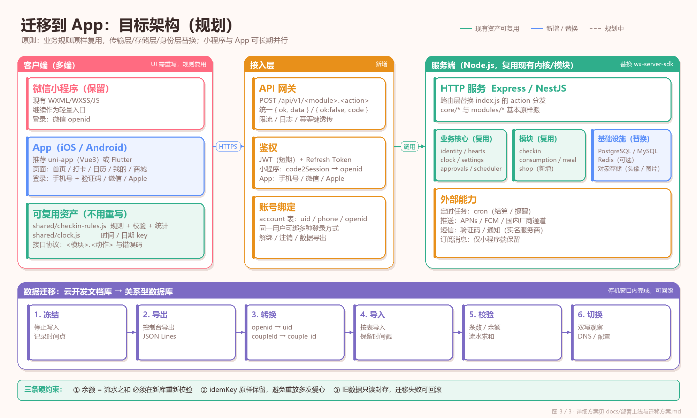
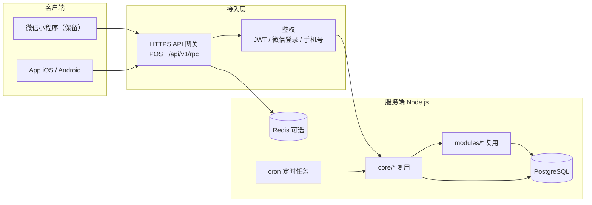

# 部署上线与迁移方案

> 适用版本：2026-10-27
> 目标：把「现在只有开发版」推进到 **体验版 → 正式小程序 → App**，每一步都能停下来、能回滚。
> 本文按阶段展开：**上线前准备 → 体验版 → 正式版 → App 迁移**，每一步都能停下来、能回滚。
> 相关文档：[`系统架构.md`](系统架构.md)、[`代码详解.md`](代码详解.md)、[`README.md`](README.md)（文档索引）。

**目录**：零、先看结论 ｜ 一、当前部署事实 ｜ 二、本地验收 ｜ **三、体验版** ｜ **四、正式上线** ｜ 五、日常运维 ｜ 六、时间线 ｜ **七、迁移到 App** ｜ 八、总检查清单 ｜ 九、决策记录 ｜ 十、附录

---

## 零、先看结论

```
现在 ──► 体验版（今天就能用，不备案）
          │  用 1~2 周，收集真实问题
          ▼
       正式上线（备案 1~3 周 + 审核 1~7 天）
          │  规则稳定、审核风险处理完
          ▼
       App 迁移（先迁后端，再迁客户端；8~12 周，可并行）
```

| 阶段 | 你要做什么 | 需要多久 | 花钱吗 |
|---|---|---|---|
| 0 · 本地验收 | 跑测试、真机点一遍 | 半天 | 0 |
| 1 · 体验版 | 上传 → 选体验版 → 加成员 → 发二维码 | 10 分钟 | 0 |
| 2 · 正式上线 | 代码改造 + 隐私指引 + 类目 + 备案 + 提审 + 发布 | 2~4 周（备案占大头） | 0 |
| 3 · App 迁移 | 后端迁移 → 小程序切后端 → App MVP → 数据迁移 → 上架 | 8~12 周（可并行） | 服务器/域名/开发者账号 |

**最重要的建议**：**别一上来就备案，也别一上来就写 App。**
先用体验版让你俩真用起来，规则尺度、扣分体验、日历好不好用，这些问题只有用起来才知道。
等规则稳定了，再花 2~4 周走正式流程；App 是「体验版/正式版都验证过之后」的下一步。

---

## 一、当前部署事实（写方案前先对齐）

| 项 | 值 | 来源 |
|---|---|---|
| 小程序 AppID | `wx4c9555768b8c728a` | `project.config.json` |
| 云开发环境 ID | `cloud1-d6gfey5n985119239` | `miniprogram/utils/config.js` |
| 云函数 | `api`（单函数，内部路由） | `cloudfunctions/api/` |
| 云函数依赖 | `wx-server-sdk ~2.6.3` | `package.json` |
| 定时触发器 | `settleHourly`，每小时第 5 分钟 | `cloudfunctions/api/config.json` |
| 数据库集合 | 7 个（profiles / couples / core_wallets / heart_logs / core_settings / core_approvals / checkins） | `core/db.js` |
| 集合权限 | 所有用户不可读写（仅云函数） | 云开发控制台 |
| 体验版二维码 | `src/images/trial-qrcode.png`，**2026-11-02 前有效** | 文件名 + 二维码文案 |
| 测试 | 53 + 88 = 141 条，当前全绿 | `scripts/*.test` 实测 |
| 小程序名称 | 「陈陈和小肚肚的小窝」（暂定） | `utils/config.js` 的 `appName` |
| 云开发套餐 | 文档记录为「微信体验版」试用，**到期前需确认额度** | 云开发控制台 |

> ⚠ 体验版二维码会过期。过期后：重新「上传 → 选为体验版」，二维码会更新；
> 成员名单不变的话，对方重进小程序即可，不用重新加人。

---

## 二、阶段 0 · 本地验收（上线前必须做）

### 2.1 跑测试

```powershell
node scripts/smoke-test.mjs     # 53 条：规则引擎 + 本地模式
node scripts/cloud-test.mjs     # 88 条：云函数全流程（假数据库）
```

两条都出现 `🎉 全部通过` 才继续。

### 2.2 开发者工具自检

- [ ] 导入项目，AppID 正确，能编译
- [ ] 首页不白屏，能显示两个爱心 / 在一起天数 / 宫格
- [ ] 打卡页：窗口内能打卡，爱心增加，日历出现标记
- [ ] 我的：资料、爱心明细、消息申请能打开
- [ ] 规则页：只读能看，编辑能提交（本地/云端校验都能拦非法值）
- [ ] 真机预览（不是模拟器）：扫码能打开，打卡能成功

### 2.3 云开发自检

- [ ] 7 个集合都建了，权限都是「所有用户不可读写」
- [ ] 云函数 `api` 已部署，日志里没有报错
- [ ] 定时触发器 `settleHourly` 在控制台能看到
- [ ] 数据库里能查到 `profiles` / `couples` / `checkins` / `heart_logs`

---

## 三、阶段 1 · 体验版（今天就能给别人用）

> 体验版**不需要备案、不需要审核**。适合对象、少数朋友。
> 个人主体未认证的体验成员上限约 15 人（以后台显示为准）。

### 3.1 上传代码

1. 微信开发者工具右上角「**上传**」
2. 版本号：`1.0.0`（建议语义化：`1.0.0`、`1.0.1`…）
3. 项目备注：写清这次改了什么，例如「打卡 v2 + 申诉 + 改规则」
4. 等进度条走完

> **上传 ≠ 部署云函数**。
> 上传只是把**小程序界面代码**送到微信服务器；云函数要单独右键 `cloudfunctions/api` →「上传并部署：云端安装依赖」。
> 顺序：**先部署云函数，再上传界面**（否则新界面调不到新 action）。

### 3.2 设为体验版

1. 打开 <https://mp.weixin.qq.com> → 左侧「管理 → **版本管理**」
2. 找到「开发版本」里刚上传的那条 → 点「**选为体验版**」
3. 页面会出现**体验版二维码**（保存到 `src/images/trial-qrcode.png`，覆盖旧的）

### 3.3 加体验成员

1. 左侧「管理 → **成员管理**」
2. 找到「**体验成员**」→ 添加
3. 输入对方的**微信号**或手机号（按提示让对方确认）

### 3.4 发给对方

对方用微信扫体验版二维码 → 打开就是你的小程序。
第一次进入会要求登记 6 项资料；登记完生成邀请码；你在首页输入邀请码，配对成功。

### 3.5 体验版的五个注意事项

| 注意 | 说明 |
|---|---|
| 二维码不是谁都能扫 | 必须在体验成员名单里，否则提示「无权限」 |
| 更新方式 | 重新上传 → 重新选为体验版；对方**杀掉小程序重进**（或清缓存）才是新版 |
| 云函数共用 | 体验版和正式版共用同一个云环境；你改数据库/规则，对方立刻受影响 |
| 不要在生产时间改规则 | 对象正在打卡时改窗口，可能让当次判定变化 |
| 二维码会过期 | 过期重新生成；成员名单不变 |

### 3.6 体验期该收集什么

用 1~2 周，重点不是加功能，而是验证：

- [ ] 你们真的会每天打开吗？哪一步最容易忘？
- [ ] 21:30–24:00 的窗口适合你们吗？分档（+2/+1/0）有没有争议？
- [ ] 漏打扣 1 分，感受如何？会不会因为怕扣分干脆不打开？
- [ ] 月度 22 天 +10，难度合理吗？
- [ ] 日历看得懂吗（粉/蓝、实心/半透/细线）？
- [ ] 申诉流程顺不顺？对方会及时处理吗？
- [ ] 首页宫格够不够？最想要的下一个功能是什么？

把这些记到 `module-dev/项目待办.md`，不要边用边大改。

---

## 四、阶段 2 · 正式上线

> 正式版 = **备案 + 审核 + 发布**。个人主体可以做工具/打卡类，但有两个硬门槛：
> ① 服务内容不能写「社交」；② 审核员必须能体验到完整功能。

### 4.1 上线前代码改造（必须）

#### ① 删掉「待上线」占位模块

审核员看到「点了提示还在做」的入口，很可能判「功能未完成」。

```js
// miniprogram/core/modules.js
// 把 consumption / meal 两条整条删掉（不是 enabled:false）
module.exports = [
  { key: 'checkin', ... enabled: true }
]
```

删完后首页只剩打卡一个宫格。等正式上线后再加回来（加回来要重新提审，但那时功能是完整的）。

#### ② 加「演示模式」（强烈建议）

问题：审核员用自己的微信打开 → 停在「还没配对」→ 点不了打卡 → 判「功能不完整」。

演示模式的目标：**不写库、不配对，也能看到打卡页长什么样**。

最小实现（半天）：

```
未配对首页底部加一个入口「看看它能做什么」
  → 跳到一个静态演示页（或打卡页的 demo=1 模式）
  → 用写死的假数据渲染：今日已打、连续 12 天、日历标记
  → 顶部明确写「演示数据，不会保存」
  → 任何写操作按钮都提示「先和 TA 配对」
```

实现要点：
- 演示数据放在页面 `data` 里，不调云函数；
- 不要复用真实 `checkin.act`，避免审核员误操作写库；
- 演示页要在 `app.json` 注册。

#### ③ 检查文案与占位

- [ ] 全局搜索「测试」「假数据」「TODO」「待上线」「占位」
- [ ] 首页/打卡页/我的页文案通读一遍，别有错别字
- [ ] 本地预览模式的提示不要出现在正式版（`mode === 'mock'` 才显示，正常不会）
- [ ] 去掉调试入口（比如强制切本地模式的按钮，可在正式版隐藏）

#### ④ 确认云开发额度

- 云开发控制台看套餐到期时间、数据库读写/存储/云函数调用额度；
- 两个人用远远够，但**试用套餐到期会停服**，上线前升级到最低付费档或确认免费额度；
- 定时触发器会计费（调用次数极少）。

#### ⑤ 清理测试数据 + 上线前别做

- [ ] 云开发数据库删掉试出来的测试记录（假打卡、重复档案、乱填的资料）
- [ ] **不要单独删 `heart_logs` 或改 `core_wallets.balance`**：要清就成对清，先备份，清完跑 `session.verify`
- [ ] 保留你们真实的 1~2 周数据（审核员看不到你的数据，但备注里可以放截图）
- [ ] 确认没有把真实手机号/姓名提交到公开仓库

**上线前别做（会被拒或封）**：

| 别做 | 原因 |
|---|---|
| 充值 / 付费买爱心 / 抽奖 | 虚拟货币 + 支付合规，个人主体碰钱必死 |
| 聊天 / 陌生人社交 | 个人主体无资质 |
| 实物礼物配送 / 交易 | 另一个量级，且容易被判电商 |
| 引导加 QQ 群、公众号、外部平台 | 小程序内引流违规 |
| 诱导分享 / 诱导关注 | 审核明确禁止 |
| 收集未在隐私指引里声明的信息 | 违规收集个人信息 |
| 名称含「情侣」或他人商标 | 名称违规/侵权 |

### 4.2 基础信息

| 项 | 建议 | 注意 |
|---|---|---|
| 小程序名称 | 「XX 打卡」「我们的小窝」这类中性名 | 避开「情侣」字眼；**个人主体一年只能改 2 次** |
| 头像 | `src/images/app-icon.jpg` | 144×144 以上，清晰 |
| 简介 | 「两个人的早睡早起打卡与爱心记录工具」 | 不要写「社交」「交友」 |
| 服务类目 | **工具 → 效率** 或 **工具 → 备忘录** | 个人主体做不了社交类目 |
| 服务内容 | 「个人生活记录 / 习惯打卡工具」 | 备案和审核都按这个口径 |

### 4.3 配「用户隐私保护指引」

路径：管理后台 → 设置 → 服务内容声明 → **用户隐私保护指引**。

本项目收集的信息（按实际填写）：

| 信息 | 用途 | 存储 | 谁能看 |
|---|---|---|---|
| 手机号 | 情侣之间身份登记 | `profiles.phone` | 双方 |
| 真实姓名 | 同上 | `profiles.realName` | 双方 |
| 生日 | 身份登记（以后可用于纪念日） | `profiles.birthday` | 双方 |
| 性别 | 身份登记 | `profiles.gender` | 双方 |
| 自我介绍 | 身份登记 | `profiles.bio` | 双方 |
| 微信 openid | 识别「你是谁」 | `profiles.openid` | 仅系统 |
| 打卡记录 | 核心功能 | `checkins` | 双方 |
| 爱心流水 | 核心功能 | `heart_logs` | 本人 + 对方余额可见 |

要点：
- 手机号是**用户手填**的（个人主体用不了「手机号快速验证」组件），但只要你收集，就必须声明；
- 真实姓名没有自动核验，也属于要声明的个人信息；
- 隐私指引里的「收集目的」要和实际一致，别写「用于营销」；
- 上线前在「设置 → 基本设置 → 用户隐私保护指引」确认已通过。

### 4.4 小程序备案（个人主体）

入口：管理后台 → 设置 → 基本设置 → **小程序备案** → 开始备案。

#### 材料

1. **主体信息**：姓名、身份证号、手机号、邮箱、证件照片/人脸核验
2. **负责人信息**：一般就是本人
3. **小程序信息**：名称、服务内容（写「个人生活记录 / 习惯打卡工具」，**不要写社交**）、服务类目
4. **承诺书**：在线签署

#### 流程与时长

```
提交
 → 平台初审（1~2 个工作日）
 → 短信核验（手机收验证码，24 小时内填）
 → 管局审核（各省不同，通常 1~20 个工作日，多数 5~10 天）
 → 下发备案号
```

**备案期间**：开发版、体验版照常可用，只是不能发布正式版。
**备案审的是「你要做什么」，不是审代码**；期间可以继续迭代体验版。

#### 常见卡点

| 卡点 | 后果 | 怎么避 |
|---|---|---|
| 服务内容写了「聊天/交友/社交」 | 个人主体直接被拒 | 改成「生活记录 / 习惯打卡」 |
| 主体信息与身份证不一致 | 驳回 | 逐字核对 |
| 短信核验超时 | 重新提交 | 24 小时内填验证码 |
| 名称/类目与备案不一致 | 驳回或延迟 | 先定名称、类目，再备案 |
| 域名/服务器（App 阶段） | 另需 ICP 备案 | 见第七节 |

### 4.5 提交审核

备案通过后：

1. 开发者工具「上传」新版本
2. 管理后台「版本管理」→ 开发版本 →「**提交审核**」
3. 填写：
   - **版本描述**：这次做了什么（例如「新增早睡早起打卡、爱心账本、缺卡申诉」）
   - **功能页面**：首页 / 打卡页 / 我的
   - **测试账号**：本项目没有账号体系，留空
   - **备注**：**必须写清双人体验方式**（见下）

#### 审核备注模板（直接抄改）

```
本小程序为「两个人配对使用」的习惯打卡工具，不是社交产品。

体验方式（请用两个微信号分别扫码）：
1. 微信 A 扫码打开 → 首次进入填写 6 项登记信息 → 首页显示 6 位邀请码；
2. 微信 B 扫码打开 → 填写登记信息 → 在首页输入 A 的邀请码 → 配对成功；
3. 配对后即可体验：早睡/早起打卡、爱心账本、当月日历、缺卡申诉、修改规则（需对方同意）。

如果暂时不方便用两个微信号，可点击首页底部「看看它能做什么」进入演示模式，
演示数据不会写入数据库，仅用于展示界面。

体验版二维码：<贴图>
```

> 审核员通常只会用一个微信号。所以**演示模式 + 备注**是双保险。

### 4.6 发布

审核通过后：

1. 管理后台「版本管理」→ 审核通过 →「**发布**」
2. 一般全量发布；发布后立即生效（或按后台提示）
3. 发布后：
   - 可以被**搜索名称**找到
   - 可以生成**正式小程序码**
   - 可以被**转发到聊天/群**，任何人点开即用

### 4.7 审核被拒的常见原因与应对

| 拒绝理由 | 真实原因 | 应对 |
|---|---|---|
| 「功能无法体验」 | 审核员配不了对 | 演示模式 + 备注写清双人流程 |
| 「服务类目不符」 | 选了社交/医疗等 | 改「工具 → 效率」 |
| 「存在未完成功能」 | 首页有「待上线」灰卡 | 删占位模块 |
| 「收集个人信息未声明」 | 隐私指引没配/不一致 | 补齐手机号/姓名等声明 |
| 「诱导分享/关注」 | 文案里有「分享给好友解锁」 | 删除诱导文案 |
| 「涉及虚拟支付」 | 爱心被描述成可购买 | 明确「爱心只能靠打卡获得，不可购买」 |
| 「名称违规/侵权」 | 名称含「情侣」或他人商标 | 改中性名 |

> 被拒不可怕，按理由改完再提；每次提审 1~7 天。**不要反复原样提交**。

---

## 五、日常运维手册

### 5.1 部署矩阵

| 改动类型 | 要做什么 | 生效范围 | 回滚 |
|---|---|---|---|
| 页面/样式/文案 | 上传 → 选体验版 / 提审 | 客户端 | 重新上传上一版 |
| 云函数逻辑 | 右键 `cloudfunctions/api` → 上传并部署 | 所有客户端立刻 | 重新部署上一版代码 |
| 规则默认值 | 改 `shared/` → `sync-rules.bat` → 部署云函数 | 云端 + 客户端生成物 | 改回 + 重新部署 |
| 数据库集合/权限 | 控制台手动 | 云端 | 改回权限 |
| 定时触发器 | 随云函数 `config.json` 部署 | 云端 | 删触发器 |
| 小程序基础信息 | 管理后台 | 线上 | 按后台限制（名称一年 2 次） |

### 5.2 集合权限检查

上线前逐项确认：

| 集合 | 权限 | 客户端可读 | 客户端可写 |
|---|---|---|---|
| `profiles` | 所有用户不可读写 | ❌ | ❌ |
| `couples` | 所有用户不可读写 | ❌ | ❌ |
| `core_wallets` | 所有用户不可读写 | ❌ | ❌ |
| `heart_logs` | 所有用户不可读写 | ❌ | ❌ |
| `core_settings` | 所有用户不可读写 | ❌ | ❌ |
| `core_approvals` | 所有用户不可读写 | ❌ | ❌ |
| `checkins` | 所有用户不可读写 | ❌ | ❌ |

> 只要有一个集合漏了，客户端就可能绕过云函数直接读/写。这是最严重的安全事故。

### 5.3 备份与恢复

**备份**（每周一次，或大改前）：

1. 云开发控制台 → 数据库 → 选择集合 → 导出（JSON/CSV）
2. 导出文件按日期命名：`backup-2026-10-27-profiles.json`
3. 存两份：本地 + 网盘/私有仓库（**不要放公开 GitHub**，含手机号/姓名）

**恢复**：

1. 控制台 → 数据库 → 导入
2. 先导入到测试环境/测试集合验证
3. 生产导入前，先导出当前数据做「回滚快照」

**注意**：
- `_id` 会保留；导入重复会冲突，必要时先清空集合；
- `heart_logs` 是账本，**不要手工删**；要修就写反向流水；
- 恢复后跑一次 `session.verify`，确认 `wallet === sum(logs)`。

### 5.4 对账与修账

**对账**：

```js
// 在云函数测试/控制台调用
session.verify  →  { wallet, ledger, ok }
```

或数据库里比对：

```
core_wallets.balance  vs  sum(heart_logs.delta where openid)
```

**修账原则**：

| 情况 | 正确做法 | 错误做法 |
|---|---|---|
| 余额多了 | 写一条负向流水，reason 写清原因 | 直接改 `balance` |
| 余额少了 | 写一条正向流水 | 直接改 `balance` |
| 流水重复 | 写反向流水冲掉，保留原记录 | 删流水 |
| 钱包文档丢失 | 调 `ensureWallet` 按流水重算 | 手工填一个数 |

### 5.5 常见故障处理（Runbook）

#### 故障 1：首页白屏 / 一直加载

1. 看云函数日志：控制台 → 云函数 → api → 日志
2. 常见：云函数没部署、集合没建、环境 ID 错、超时
3. 应急：首页错误卡片点「先用本地模式」，至少能看界面
4. 修复后：重新部署云函数 → 编译

#### 故障 2：打卡提示「没有这个功能/动作」

- 客户端比云函数新：云函数没部署 → 部署
- 云函数比客户端新：客户端是旧版 → 重新编译/上传

#### 故障 3：漏打没扣分

1. 定时触发器在不在？控制台 → 云函数 → api → 定时触发器
2. 云函数日志里有没有 `settle` 报错
3. 余额是不是 0（扣不动）
4. 打卡日是不是在 `pairedAt` 之前（不结算）
5. 手动让用户打开一次打卡页（惰性结算）

#### 故障 4：爱心对不上

1. 调 `session.verify` 看 `wallet` / `ledger`
2. 查 `heart_logs` 是否有重复 `idemKey`
3. 查是否有直接改 `balance` 的历史操作
4. 按 5.4 的原则修，不要删记录

#### 故障 5：体验版打不开 / 提示无权限

1. 扫码的人是否在体验成员名单
2. 二维码是否过期
3. 是否被微信缓存了旧版本 → 杀掉小程序重进

#### 故障 6：云开发套餐到期

- 控制台会提前提示；到期后云函数/数据库不可用
- 处理：升级套餐或迁移（见第七节）
- 预防：上线前确认到期时间，设日历提醒

### 5.6 成本

| 项 | 费用 | 说明 |
|---|---|---|
| 小程序注册（个人） | 0 | — |
| 云开发 | 免费额度内基本 0；超了几块~几十块/月 | 两人用，主要成本是存储和调用 |
| 备案 | 0 | 自己跑流程 |
| 域名（App 阶段） | 约 50~100 元/年 | 需要 ICP 备案 |
| 服务器（App 阶段） | 约 50~150 元/月 | 2C2G 够两个人用 |
| 短信（App 阶段） | 约 0.04~0.06 元/条 | 登录验证码 |
| Apple 开发者 | 99 美元/年 | 上架 iOS 必须 |
| 安卓商店 | 多数免费；部分要软著 | 软著可自己申请或代办 |

---

## 六、从「体验版」到「正式版」的时间线（建议）

```
第 1 天        体验版上线，你俩开始用
第 1~2 周      只记录问题，不改大功能
第 2 周末      根据问题改一轮；重新上传体验版
第 3 周        删占位模块 + 加演示模式 + 配隐私指引 + 定名称/类目
第 3 周        提交备案（等待期继续迭代体验版）
第 4~5 周      备案通过 → 上传 → 提审（备注写清双人体验）
第 5~6 周      审核通过 → 发布
```

> 备案和审核的等待期不是「空窗」，可以继续在体验版改代码；但**不要在上线前一周大改规则**，否则审核员看到的和你描述的不一致。

---

## 七、阶段 3 · 迁移到 App

> 这是「以后」的事。先把小程序用顺，再决定要不要付出这个成本。

### 7.1 先问：真的需要 App 吗？

| 你想要 | 小程序够不够 | 是否值得迁 App |
|---|---|---|
| 两个人每天打卡 | ✅ 够 | ❌ 不值得 |
| 给更多朋友用 | 体验版上限 ~15 人；正式版不限 | 正式版就够，不必 App |
| 更顺滑的动画/手势 | 小程序一般 | 看预算 |
| 后台推送/常驻提醒 | 小程序受限（订阅消息一次性） | ✅ App 更合适 |
| 桌面图标/独立品牌 | 小程序可加桌面 | 不一定 |
| 不想受微信审核/类目限制 | 受限 | ✅ App 更自由，但合规成本更高 |
| 想接支付/会员 | 个人主体做不了 | App 也要企业资质/支付通道 |

**结论**：如果只是「两个人打卡 + 偶尔提醒」，小程序正式版足够。
App 的真正理由是「推送/独立品牌/更自由的交互」，而不是「小程序不够用」。

### 7.2 目标架构





### 7.3 三条技术路线

| 路线 | 技术 | 优点 | 缺点 | 适合谁 |
|---|---|---|---|---|
| **A. uni-app（Vue3）** | 一套代码 → 小程序 + App + H5 | 学习成本低、生态成熟、可先出 App | 复杂动画/性能不如原生；需要重写页面 | **推荐**（你已会 JS） |
| B. Flutter | Dart | 性能/一致性最好 | 要学 Dart；现有 JS 资产复用少 | 想要长期做 App、愿意学 |
| C. React Native | React | 生态大、原生能力好 | 构建链复杂；Windows 开发 iOS 不便 | 熟悉 React 的团队 |
| D. WebView 套壳 | H5 + 壳 | 最快 | 体验差、审核可能拒（4.2） | 只做内部工具 |

**推荐 A（uni-app）**：
- 你现在的业务规则是纯 JS（`shared/checkin-rules.js`），可以直接复用；
- 页面要从 WXML 改成 Vue 模板，但结构一一对应；
- 以后想回小程序，也能一套代码多端发。

### 7.4 现有资产复用盘点

| 资产 | 复用程度 | 说明 |
|---|---|---|
| `shared/checkin-rules.js` | **100%** | 纯 JS，无小程序 API；规则/校验/统计直接用 |
| `shared/clock.js` | **100%** | 纯 JS |
| 业务概念（dayKey / idemKey / 账本） | **100%** | 设计不变 |
| `core/identity.js`、`hearts.js`、`context.js` | **60~80%** | 逻辑保留，`db` 访问改成 SQL repository |
| `modules/checkin/index.js` | **70%** | 流程保留，`ctx.db` 换成 repository |
| 路由 `index.js` | **30%** | action 分发逻辑保留，换成 HTTP 路由 |
| 页面 WXML/WXSS | **0~20%** | 结构/样式可参考，代码要重写 |
| 数据 | **100%** | 可迁移，见 7.7 |
| 测试 | **50%** | 规则测试直接复用；云函数测试要改成 HTTP 集成测试 |

### 7.5 后端迁移：从云函数到 HTTP 服务

#### 方案对比

| 方案 | 做法 | 工作量 | 风险 |
|---|---|---|---|
| **A. 适配器移植** | 写一个 `db-sql-adapter` 模拟云开发 `collection/where/get/add` API，现有代码几乎不改 | 小（1~2 周） | 查询语义/性能差；`_.inc`、`limit`、`count` 都要模拟；不适合长期 |
| **B. Repository 重写（推荐）** | 保留 `core/*` 的业务逻辑，把 `store.js` / `identity.js` / `hearts.js` 的数据库访问改成 SQL | 中（2~3 周） | 要逐条改，但有测试兜底 |
| C. 重写全部 | 新框架重写 | 大 | 容易丢业务细节 |

**推荐 B**：保留「业务规则」和「ctx 契约」，只替换「存储」和「传输」。

#### 目录建议

```
server/
├─ src/
│  ├─ index.js                Express/NestJS 启动
│  ├─ routes/
│  │  ├─ rpc.js               POST /api/v1/rpc  { action, payload }
│  │  ├─ auth.js              登录 / 刷新 token
│  │  └─ health.js
│  ├─ core/                   从 cloudfunctions/api/core 迁过来
│  │  ├─ identity.js
│  │  ├─ hearts.js
│  │  ├─ clock.js
│  │  ├─ settings.js
│  │  ├─ approvals.js
│  │  ├─ scheduler.js
│  │  └─ context.js
│  ├─ modules/
│  │  └─ checkin/
│  │     ├─ index.js
│  │     ├─ rules.js          ← 由 shared/ 生成/引用
│  │     └─ store.js          ← 改成 SQL
│  ├─ db/
│  │  ├─ pool.js
│  │  └─ migrations/
│  └─ shared/                 ← 构建时从仓库根 shared/ 复制进来（或做成 workspace 包）
├─ package.json
└─ Dockerfile
```

#### 接口协议：先别改

建议**先保留 `{ action, payload }` 协议**，只把传输从 `wx.cloud.callFunction` 换成 HTTPS：

```
POST /api/v1/rpc
Authorization: Bearer <token>
Content-Type: application/json

{ "action": "checkin.act", "payload": { "type": "sleep" } }

→ { "ok": true, "serverNow": 1730000000000, "reward": { ... }, "detail": { ... } }
```

好处：
- 前端调用层只改一个函数；
- 云函数里的路由/内核/模块几乎原样搬；
- 测试可以复用大部分断言。

以后再考虑 RESTful：

| action | REST 形式 |
|---|---|
| `session.get` | `GET /api/v1/me` |
| `checkin.detail` | `GET /api/v1/checkin` |
| `checkin.act` | `POST /api/v1/checkin/actions` |
| `approvals.list` | `GET /api/v1/approvals` |
| `approvals.decide` | `POST /api/v1/approvals/:id/decision` |

#### 鉴权替换

| 云开发 | 自建后端 |
|---|---|
| `cloud.getWXContext().OPENID` | 中间件解析 JWT → `req.user` |
| 小程序登录：微信自动带 openid | 小程序 `wx.login` → `code` → 后端 `code2Session` → 绑定/创建用户 → 发 JWT |
| App 登录：无 | 手机号 + 短信验证码；可选微信 OpenSDK / Apple 登录 |

> `context.create(mod, openid)` 的签名不用改：把 `openid` 换成 `userId` 即可。
> 关键是**所有业务代码仍然只认「当前用户 id」**，不认 token 细节。

#### 数据库迁移（PostgreSQL 示例）

```sql
create table users (
  id            uuid primary key default gen_random_uuid(),
  wechat_openid text unique,
  phone         text unique,
  created_at    timestamptz not null default now()
);

create table profiles (
  user_id       uuid primary key references users(id),
  display_id    text unique,
  real_name     text,
  phone         text,
  birthday      date,
  gender        text,
  bio           text,
  avatar_emoji  text,
  updated_at    timestamptz
);

create table couples (
  id            uuid primary key,
  invite_code   text unique not null,
  status        text not null check (status in ('pending','active','dissolved')),
  created_at    timestamptz,
  paired_at     timestamptz,
  dissolved_at  timestamptz
);

create table couple_members (
  couple_id uuid references couples(id),
  user_id   uuid references users(id),
  primary key (couple_id, user_id)
);

create table wallets (
  user_id    uuid primary key references users(id),
  balance    integer not null default 0 check (balance >= 0),
  updated_at timestamptz
);

create table heart_logs (
  id         bigserial primary key,
  user_id    uuid not null references users(id),
  couple_id  uuid not null references couples(id),
  date_key   date not null,
  created_at timestamptz not null,
  delta      integer not null,
  reason     text not null,
  module     text not null,
  ref_id     text,
  idem_key   text
);

-- 幂等：同一个用户同一个 idemKey 只能有一条
-- （没有幂等键时存 NULL；PostgreSQL 的唯一索引允许多个 NULL）
create unique index heart_logs_idem
  on heart_logs(user_id, idem_key);

create table settings (
  couple_id  uuid references couples(id),
  module     text not null,
  patch      jsonb not null,
  history    jsonb not null default '[]',
  updated_at timestamptz,
  primary key (couple_id, module)
);

create table approvals (
  id          uuid primary key,
  module      text not null,
  type        text not null,
  couple_id   uuid not null references couples(id),
  from_user   uuid not null references users(id),
  to_user     uuid not null references users(id),
  ref_id      text,
  title       text,
  summary     text,
  payload     jsonb not null default '{}',
  status      text not null check (status in ('pending','approved','rejected','expired')),
  created_at  timestamptz not null,
  decided_at  timestamptz,
  decide_user uuid
);

-- 同一件事同时只能有一个 pending
create unique index approvals_pending
  on approvals(module, type, ref_id, from_user)
  where status = 'pending';

create table checkins (
  id         bigserial primary key,
  user_id    uuid not null references users(id),
  couple_id  uuid not null references couples(id),
  date_key   date not null,
  type       text not null,
  at         timestamptz not null,
  hearts     integer,
  source     text not null default 'normal'
);

create unique index checkins_unique
  on checkins(user_id, couple_id, date_key, type);
```

**这些索引就是「幂等」的最终答案**：
数据库唯一约束比「先查后写」可靠，即使两个请求同时到，也只有一个能插入。

#### 账本事务（关键）

```js
// 扣款：必须在事务里，先锁钱包，再校验，再写流水
await db.tx(async (t) => {
  const w = await t.one(
    'select balance from wallets where user_id = $1 for update', [userId]
  )
  if (w.balance + delta < 0) throw new BizError('INSUFFICIENT', '爱心不够啦')

  // 幂等：如果这笔已经记过，insert 不会返回行，直接结束（钱包不能再加/扣）
  const inserted = await t.one(
    `insert into heart_logs (user_id, couple_id, date_key, created_at, delta, reason, module, ref_id, idem_key)
     values ($1,$2,$3,now(),$4,$5,$6,$7,$8)
     on conflict (user_id, idem_key) do nothing
     returning id`,
    [userId, coupleId, dateKey, delta, reason, module, refId, idemKey || null]
  )
  if (!inserted) return

  await t.none(
    'update wallets set balance = balance + $2, updated_at = now() where user_id = $1',
    [userId, delta]
  )
})
```

> 注意 `idem_key` 为空时要存 `NULL`（不是空字符串），否则所有「无幂等键」的流水会互相冲突。

> 这段是「以后上商城」的地基。现在云函数里没有事务，是因为两个人用、风险极低；
> 一旦涉及真扣爱心/真钱，必须补上。

#### 定时任务

| 云开发 | 自建 |
|---|---|
| `config.json` 的 `triggers` | 服务器 `cron` / 云厂商定时任务 |
| `settle.run` 只能 Timer 调 | 用一个内部 token 保护 `/internal/settle` |
| 无重试 | 加失败重试 + 告警 |

### 7.6 账号体系迁移

这是 App 迁移里最容易被低估的一块。

| 问题 | 小程序现状 | App 需要 |
|---|---|---|
| 用户是谁 | 微信 openid | `users.id` + 多种登录方式 |
| 登录方式 | 无感（微信） | 手机号验证码 / 微信 / Apple |
| 一个用户多端 | 天然同一 openid | 需要 account ↔ 多登录方式绑定 |
| 注销 | 无 | 必须提供（App Store 要求） |
| 换手机 | 微信即身份 | 手机号即身份 |

建议表：

```sql
create table user_identities (
  id         bigserial primary key,
  user_id    uuid not null references users(id),
  provider   text not null,          -- wechat_mini / wechat_app / phone / apple
  external_id text not null,         -- openid / phone / apple sub
  created_at timestamptz not null default now(),
  unique (provider, external_id)
);
```

迁移时：
- 老用户用原 `openid` 建一条 `wechat_mini` 身份；
- 用户在 App 首次登录手机号后，把手机号身份绑到同一个 `user_id`；
- 没绑定手机号的老用户，App 端看不到数据 —— 所以要提前引导绑定。

> 对你们两个人来说，最简单的做法是：**迁移时人工把两个 openid 映射到两个手机号**，
> 不做复杂的多身份系统。以后要扩人再补。

### 7.7 数据迁移：云开发 → 关系型数据库

#### 7.7.1 映射表

| 云开发 | 新库 | 转换 |
|---|---|---|
| `profiles.openid` | `users.wechat_openid` | 原样 |
| `profiles._id` | 丢弃 | 新库用 uuid |
| `profiles.*` | `profiles.*` | 字段改名（userId→display_id） |
| `couples._id` | `couples.id` | 生成 uuid，建映射表 |
| `couples.members[]` | `couple_members` | 一行一人 |
| `couples.status` | `couples.status` | 原样 |
| `couples.inviteCode` | `couples.invite_code` | 原样 |
| `core_wallets._id` | `wallets.user_id` | openid → user_id |
| `core_wallets.balance` | `wallets.balance` | 原样 |
| `heart_logs.openid` | `heart_logs.user_id` | openid → user_id |
| `heart_logs.coupleId` | `heart_logs.couple_id` | 旧 coupleId → 新 uuid |
| `heart_logs.date` | `heart_logs.date_key` | `YYYY-MM-DD` → date |
| `heart_logs.at` | `heart_logs.created_at` | 毫秒 → timestamptz |
| `heart_logs.delta/reason/module/refId/idemKey` | 同名列 | 原样，**idemKey 必须保留**；空字符串转 `NULL` |
| `core_settings.patch/history` | `settings.patch/history` | JSON → jsonb |
| `core_approvals.*` | `approvals.*` | 字段改名 |
| `checkins.date` | `checkins.date_key` | 原样 |
| `checkins.at` | `checkins.at` | 毫秒 → timestamptz |

#### 7.7.2 迁移步骤（停机窗口 30~60 分钟）

```
1. 冻结写入
   - 发公告：今晚 23:00–24:00 维护
   - 部署一个「维护中」开关（云函数返回友好提示），或直接低峰操作

2. 全量导出
   - 控制台逐个集合导出 JSON Lines（7 个文件）
   - 记录导出时间点 T0

3. 转换（本地脚本）
   - 建 openid → user_id 映射
   - 建旧 coupleId → 新 uuid 映射
   - 字段改名、时间戳转 ISO
   - 过滤「从未登记」的空档案（`userId` 为空），或让 `display_id` 为 NULL
   - `idemKey = ''` 转 NULL
   - 生成 CSV/JSON，按表拆分

4. 导入
   - 按依赖顺序：users → profiles → couples → couple_members →
     wallets → heart_logs → settings → approvals → checkins
   - 关闭外键/用事务，失败回滚

5. 校验（必须全过）
   - 每张表条数 = 源集合条数（允许过滤掉无效数据，但要记录）
   - 每个钱包 balance = sum(heart_logs.delta)
   - 没有重复 idemKey
   - 每对 active couple 恰好 2 个成员
   - 抽 3 个用户，逐条核对最近 10 笔流水

6. 切换
   - 小程序切到新 API（见 7.8 的开关）
   - App 内测
   - 观察 24 小时

7. 回滚预案
   - 旧云环境保持只读，不删数据
   - 切换开关改回云函数
   - 新库保留，人工比对差异
```

#### 7.7.3 校验 SQL

```sql
-- ① 余额 = 流水之和
select w.user_id, w.balance, coalesce(sum(h.delta), 0) as ledger
from wallets w
left join heart_logs h on h.user_id = w.user_id
group by w.user_id, w.balance
having w.balance <> coalesce(sum(h.delta), 0);

-- ② 重复幂等键
select user_id, idem_key, count(*)
from heart_logs
where idem_key is not null and idem_key <> ''
group by user_id, idem_key
having count(*) > 1;

-- ③ 每对 active 关系必须两人
select c.id, count(m.user_id) as n
from couples c
left join couple_members m on m.couple_id = c.id
where c.status = 'active'
group by c.id
having count(m.user_id) <> 2;

-- ④ 孤儿记录
select count(*) from checkins c
left join users u on u.id = c.user_id
where u.id is null;

-- ⑤ 流水总和与旧库总额对比（迁移前先算好旧值）
select sum(delta) from heart_logs;
```

#### 7.7.4 迁移脚本骨架

```js
// scripts/migrate-to-sql.mjs（示例，不是现成脚本）
import fs from 'node:fs'

const users = new Map()      // openid -> uuid
const couples = new Map()    // old coupleId -> uuid

function toIso(ms) { return new Date(ms).toISOString() }
function uuid() { return crypto.randomUUID() }

// 1. 先读 profiles，建用户映射
const profiles = readJsonl('export/profiles.jsonl')
for (const p of profiles) {
  const id = uuid()
  users.set(p.openid, id)
  // insert into users / profiles ...
}

// 2. 读 couples，建关系映射
const coupleDocs = readJsonl('export/couples.jsonl')
for (const c of coupleDocs) {
  const id = uuid()
  couples.set(c._id, id)
  // insert into couples / couple_members ...
}

// 3. 流水（idemKey 原样保留！）
for (const l of readJsonl('export/heart_logs.jsonl')) {
  // insert into heart_logs (user_id, couple_id, ..., idem_key)
}

// 4. 最后用 SQL 校验
```

> **不要边迁移边改业务规则**。迁移只做「搬运 + 校验」，规则变更等迁移完成后单独做。

### 7.8 客户端迁移：小程序 → App

#### 7.8.1 页面映射

| 小程序 | uni-app | 工作量 |
|---|---|---|
| `pages/home/home` | `pages/home/index.vue` | 中（宫格 + 会话） |
| `pages/mine/mine` | `pages/mine/index.vue` | 中 |
| `pages/register/register` | `pages/register/index.vue` | 中（表单） |
| `pages/approvals/approvals` | `pages/approvals/index.vue` | 小 |
| `pages/ledger/ledger` | `pages/ledger/index.vue` | 小 |
| `pages/m/checkin/index` | `pages/checkin/index.vue` | 大（日历 + 倒计时 + 打卡） |
| `pages/m/checkin/rules/index` | `pages/checkin/rules.vue` | 中（表单 + 校验） |

#### 7.8.2 语法映射

| 小程序 | uni-app / Vue |
|---|---|
| `Page({ data, onLoad })` | `<script setup>` + `onLoad` / `onMounted` |
| `this.setData({ x })` | `x.value = ...`（ref） |
| `{{x}}` | `{{ x }}` / `:text="x"` |
| `wx:if` | `v-if` |
| `wx:for` | `v-for` |
| `bindtap` | `@click` |
| `data-type` + `dataset` | `@click="fn(item)"` |
| `wx.navigateTo` | `uni.navigateTo` |
| `wx.requestSubscribeMessage` | 仅小程序端；App 用推送 |
| `wx.cloud.callFunction` | `uni.request` → `core/api.js` |
| `wx.setStorageSync` | `uni.setStorageSync` |
| `rpx` | `rpx`（uni-app 支持） |
| `app.wxss` | `App.vue` 的全局 `<style>` |

#### 7.8.3 调用层改造

```js
// core/api.js（App 版）
const BASE = 'https://api.example.com'

function call(action, payload) {
  return new Promise((resolve, reject) => {
    uni.request({
      url: BASE + '/api/v1/rpc',
      method: 'POST',
      header: { Authorization: 'Bearer ' + getToken() },
      data: { action, payload: payload || {} },
      success: (res) => {
        if (res.statusCode === 401) { refreshToken().then(() => call(action, payload).then(resolve)) ; return }
        resolve(res.data)
      },
      fail: (err) => reject(err)
    })
  })
}
```

#### 7.8.4 App 端要额外处理的

- **安全区/刘海屏**：`env(safe-area-inset-bottom)`；
- **返回键/手势**：安卓物理返回、iOS 侧滑；
- **推送权限**：首次启动不要立刻弹，等用户点「提醒我」；
- **离线**：缓存最近一次 `checkin.detail`，弱网时先显示；
- **本地通知**：只能做「已打开 App 时」的提醒，真正的定时提醒要靠服务端推送；
- **版本更新**：App 不能像小程序一样即时更新，要做「检查更新」；
- **崩溃日志**：接 Sentry/友盟等（可选）。

### 7.9 双端并行与灰度

推荐顺序：

```
第 1 步：后端上线（新库 + HTTP API），但只有内部测试用
第 2 步：小程序切到新后端（通过远程开关），观察 1~2 周
第 3 步：App 内测（TestFlight / APK），只给你俩
第 4 步：App 正式上架；小程序继续保留
```

**关键：小程序先切后端**。
这样数据只有一份（新库），App 上线时不用再做一次迁移。

切换开关的实现（不改客户端也能回滚）：

```
云函数 session.get 返回 { apiBase: 'https://api.example.com' }  ← 远程配置
小程序 core/api.js 优先用 apiBase；失败则回退云函数
```

或者更简单：发一版小程序，`api.js` 里写死新 API；出问题就重新发上一版（要审核，慢）。
所以推荐「远程开关 + 云函数代理」的过渡方案：

```
小程序 → 云函数 api（代理） → 新后端 HTTPS
```

代理层只做转发和 token 转换，等 App 稳定后再让小程序直连。

### 7.10 App 上架合规

| 项 | 是否必须 | 说明 |
|---|---|---|
| ICP 备案（域名） | 大陆服务器必须 | 用大陆服务器就要备案；香港/海外可免但慢 |
| 公安联网备案 | 通常要 | 备案后 30 日内 |
| 软件著作权 | 安卓商店常要 | 可自己申请（免费，周期长）或代办 |
| 隐私政策 + 用户协议 | 必须 | 要能在 App 内打开，不能只是链接到网页 |
| 账号注销 | 必须（App Store） | 提供入口，且真能删/匿名化 |
| 权限说明 | 必须 | 通知、相册等要说明用途 |
| Apple 开发者账号 | iOS 必须 | 99 美元/年 |
| 年龄分级 | 商店要求 | 4+ / 12+ 等 |
| 数据安全 | 必须 | HTTPS、密码哈希、PII 最小化 |

> 如果只是你俩用，可以先走 **TestFlight（iOS，90 天一轮）+ 安卓 APK 直装**，不上架；
> 但这不是长期方案，且 iOS 需要开发者账号。

### 7.11 排期与成本（一个人 + AI 的节奏）

| 阶段 | 内容 | 估时（业余） | 可并行 |
|---|---|---|---|
| P0 | 冻结范围、备份、买域名/服务器、备案 | 1 周 | 备案可并行 |
| P1 | 新库 + 后端 API + 移植 checkin | 2~3 周 | — |
| P2 | 小程序切新后端 + 双端联调 | 1 周 | — |
| P3 | App MVP（uni-app 页面 + 登录 + 推送） | 4~6 周 | 商店素材/软著 |
| P4 | 数据迁移 + 内测 + 修 bug | 1~2 周 | — |
| P5 | 上架审核 | 1~4 周 | — |
| **合计** | — | **8~12 周** | 合规越早启动越好 |

**成本（估算，按实际为准）**：

| 项 | 首年 |
|---|---|
| 域名 | 50~100 元 |
| 服务器（2C2G） | 600~1800 元 |
| 短信 | 几十元 |
| Apple 开发者 | 约 700 元 |
| 软著/代办 | 0~1000 元 |
| 推送服务 | 免费额度通常够 |
| **合计** | **约 1500~3500 元** |

### 7.12 迁移风险清单

| 风险 | 概率 | 影响 | 应对 |
|---|---|---|---|
| 数据迁移丢账/错账 | 中 | 高 | 停机 + 全量校验 + 旧库只读保留 30 天 |
| 小程序切后端需要重新审核 | 高 | 中 | 提前 2 周发版；用远程开关/代理过渡 |
| App 审核被拒（4.2 功能单薄） | 中 | 中 | 做完整功能 + 演示账号 + 隐私政策 |
| 推送到达率低 | 高 | 中 | 多通道（APNs/FCM/厂商）；站内信兜底 |
| 双端维护成本 | 高 | 中 | 共用后端 + shared 规则；不要复制业务逻辑 |
| 账号绑定丢数据 | 中 | 高 | 迁移时人工核对两个 openid ↔ 手机号 |
| 合规没做完就上架 | 中 | 高 | ICP/隐私/注销先做，再提审 |
| 范围膨胀（想加聊天/相册） | 高 | 高 | 明确「这一版只迁移，不加新功能」 |

---

## 八、总检查清单

### 体验版前

- [ ] 两套测试全绿（141 条）
- [ ] 云函数已部署，定时触发器在
- [ ] 7 个集合都建了，权限全关
- [ ] `envId` 正确
- [ ] 真机点过一遍完整流程

### 正式版前

- [ ] 删掉占位模块
- [ ] 演示模式可用
- [ ] 名称/头像/简介/类目定好
- [ ] 隐私保护指引已配
- [ ] 备案通过
- [ ] 审核备注写清双人体验方式
- [ ] 云开发套餐未到期
- [ ] 数据已备份
- [ ] 回滚方案想好（重新上传上一版）

### App 迁移前

- [ ] 确认「真的需要 App」（推送/品牌/自由度）
- [ ] 小程序正式版稳定运行 ≥1 个月
- [ ] 新后端 API 与旧 action 一一对应
- [ ] 数据迁移脚本 + 校验 SQL 跑通
- [ ] 小程序已支持远程切换后端
- [ ] 隐私政策/账号注销/ICP 备案启动
- [ ] 回滚预案演练过

---

## 九、决策记录与待定问题

### 已定

| 日期 | 决策 | 理由 |
|---|---|---|
| 2026-10-26 | 先体验版，不急着备案 | 先验证习惯，备案等待期长 |
| 2026-10-27 | 正式版前必须删占位模块 + 加演示模式 | 审核员配不了对是最大风险 |
| 2026-10-27 | App 迁移顺序：后端 → 小程序切后端 → App | 避免数据双份；小程序先验证新后端 |
| 2026-10-27 | App 技术路线优先 uni-app | 复用 JS 规则，学习成本低 |

### 待定（做到那一步再定）

| 问题 | 最晚决策点 | 建议 |
|---|---|---|
| 是否真的要做 App | 小程序正式版稳定 1 个月后 | 先看推送是不是刚需 |
| App 登录方式 | 后端设计前 | 手机号验证码最简单；微信/Apple 后加 |
| 自建服务器还是 Serverless | 后端设计前 | 两人用，最低配云服务器足够 |
| 是否保留小程序 | App 上线后 | 保留，作为轻量入口 |
| 数据迁移停机窗口 | 迁移前 1 周 | 晚上 30~60 分钟 |
| 是否请人做 UI | App 开发前 | 先用现有设计，别卡在配色 |

---

## 十、附录

### A. 审核备注模板（完整版）

```
【产品说明】
本小程序是两个人的习惯打卡工具，不是社交/交友产品。核心功能：
早睡早起打卡 → 按打卡时间给爱心 → 爱心记录在个人账本 → 缺卡可申诉。
没有充值、没有付费、没有陌生人社交、没有聊天。

【体验路径】
方式一（完整体验）：
1. 用微信号 A 扫码，首次进入填写 6 项登记信息，首页生成 6 位邀请码；
2. 用微信号 B 扫码，填写登记信息，在首页输入 A 的邀请码，配对成功；
3. 配对后可体验打卡、日历、爱心明细、缺卡申诉、修改规则（需对方同意）。

方式二（演示模式）：
如果只有一个微信号，可点击首页底部「看看它能做什么」，
进入演示模式查看打卡页/日历界面。演示数据不写入数据库，不会产生真实记录。

【测试账号】
本产品使用微信身份，无需账号密码。

【体验版二维码】
（贴图）
```

### B. 备案服务内容文案

```
小程序名称：XX 打卡
服务内容：个人生活记录、习惯打卡工具
服务类目：工具 > 效率
功能说明：用户记录每日早睡早起打卡，查看个人记录与统计；
          仅限用户本人及配对用户查看，不提供社交、聊天、支付功能。
```

### C. 隐私保护指引字段表

| 字段 | 是否必填 | 用途 | 是否共享 |
|---|---|---|---|
| 微信 openid | 系统获取 | 识别用户身份 | 否 |
| 用户 ID | 用户填写 | 双方互相称呼 | 仅配对双方 |
| 真实姓名 | 用户填写 | 身份登记 | 仅配对双方 |
| 手机号 | 用户填写 | 身份登记 | 仅配对双方 |
| 生日 | 用户填写 | 身份登记 | 仅配对双方 |
| 性别 | 用户选择 | 身份登记 | 仅配对双方 |
| 自我介绍 | 用户填写 | 身份登记 | 仅配对双方 |
| 打卡记录 | 系统生成 | 核心功能 | 仅配对双方 |
| 爱心流水 | 系统生成 | 核心功能 | 本人；对方仅见余额 |

### D. App 权限清单（建议）

| 权限 | 是否申请 | 用途 |
|---|---|---|
| 通知 | 是（用户点提醒时） | 打卡提醒、审批提醒 |
| 网络 | 是 | 调 API |
| 相册/相机 | 暂不 | 以后头像上传再申请 |
| 定位 | 否 | 不需要 |
| 通讯录 | 否 | 不需要 |
| 麦克风 | 否 | 不需要 |

### E. 相关文档

| 文档 | 用途 |
|---|---|
| [`README.md`](README.md) | 文档索引 / 按角色阅读路径 |
| [`系统架构.md`](系统架构.md) | 部署架构、扩展方式 |
| [`代码详解.md`](代码详解.md) | 代码改动点、通知实现 |
| [`../module-dev/项目交接.md`](../module-dev/项目交接.md) | 当前状态、技术债、交接 |
| [`../module-dev/项目待办.md`](../module-dev/项目待办.md) | 上线前 TODO |
